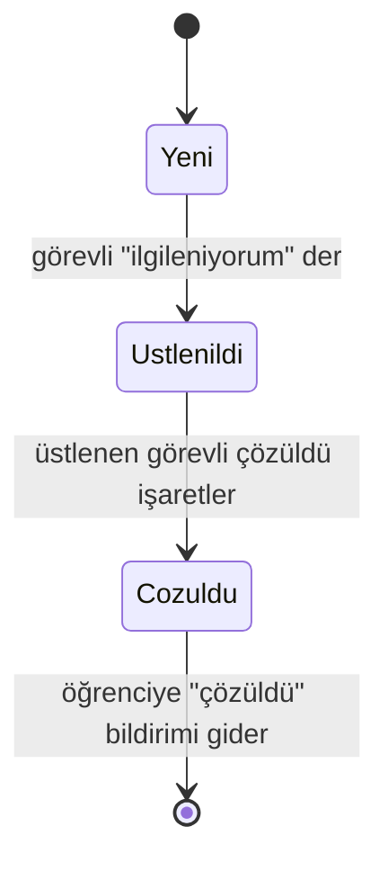
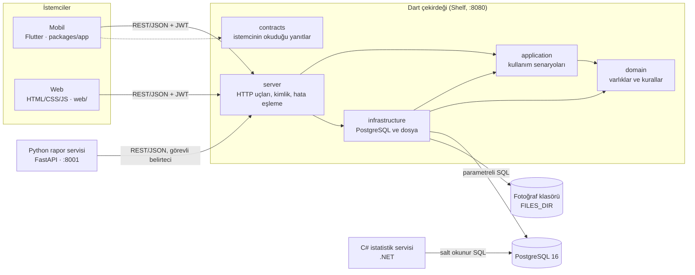
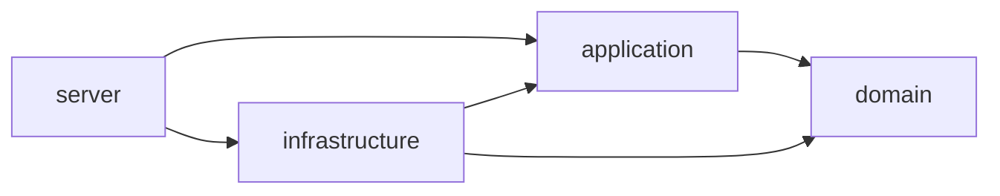

# Campus Report

[](https://sonarcloud.io/summary/new_code?id=HuseyinEmreTech_Yapay-Zeka-Destekli-Yazilim-Gelistirme) [](https://sonarcloud.io/summary/new_code?id=HuseyinEmreTech_Yapay-Zeka-Destekli-Yazilim-Gelistirme)

**Kampüs sorun bildirim sistemi.** Öğrenci kampüste gördüğü sorunu fotoğraf ve konumla bildirir, görevli "ilgileniyorum" diyerek üstlenir ve çözer, çözülünce öğrenciye sistemde haber gider.

*Yapay Zeka Destekli Yazılım Geliştirme dersi dönem projesi. **Yedi kişilik ekip**: Hüseyin Emre, Yusuf Ekenel, Ertuğrul Pekdemir, Çağdaş Kemal Ağca, Fatma Müberra Yener, Emir Kerem Çakıcı, Murat Yaman.*

## Ekip ve çalışma düzeni

Proje ekiple, GitHub üzerinde branch ve Pull Request ile yürütülür. Ders cuma günleri; dönem 15 ders haftası, son teslim 23 Aralık 2026 ([teslim planı](proje-bilgileri/planlar/2026-11-24-teslim-plani.md)). Ekibe yeni katılan: [Başlangıç rehberi](proje-bilgileri/ekip/00-baslangic-rehberi.md).

| Kişi | GitHub | Rol | Ana sorumluluk |
| --- | --- | --- | --- |
| Hüseyin Emre | `HuseyinEmreTech` | Teknik lider | `domain`, `application`, `contracts`, CI, kabul testleri, PR incelemesi, mimari kararlar |
| Ertuğrul Pekdemir | `ertrlpkdmr` | Backend Infrastructure | `infrastructure` (PostgreSQL, dosya depolama, EXIF, migration, Docker) |
| Çağdaş Kemal Ağca | `Cagdas3307` | Backend API / Server | `server` (Shelf endpoint'ler, auth, hata eşleme, middleware, OpenAPI) |
| Yusuf Ekenel | `yusufekenel` | Flutter Mobil | `campus_app` mobil ekranları (Android, iOS, Web), platform kanalları |
| Fatma Müberra Yener | `muberrayener` | Flutter Web / Test & QA | `campus_app` web responsive, test stratejisi, SonarQube, otomasyon |
| Emir Kerem Çakıcı | `KeremC23` | Esnek Destek / Test & Kalite | Kabul testleri, entegrasyon/E2E test, hata takibi, dokümantasyon |
| Murat Yaman | `yamanmurat761` | Web İstemcisi | Ayrı web istemcisi (HTML/CSS/JS), filtre/sayfalama, SQL inceleme |

**Kurallar:** `main`'e doğrudan commit yok; her iş kendi branch'inde küçük PR ile gelir, en az bir kişi inceler. Herkes her hafta en az bir anlamlı commit atar. Commit mesajı önekli ve Türkçe (`feat:`, `fix:`, `docs:`, `test:`). Şifre, token ve gerçek öğrenci verisi repo'ya girmez. Haftalık hedefler, kişi bazlı görevler ve takvim: [Ekip ve 15 haftalık yol haritası](proje-bilgileri/10-ekip-ve-yol-haritasi.md).

## İçindekiler

1. [Proje nedir?](#1-proje-nedir)
2. [Problem ve amaç](#2-problem-ve-amaç)
3. [Nasıl çalışır?](#3-nasıl-çalışır)
4. [Özellikler ve kapsam](#4-özellikler-ve-kapsam)
5. [Mimari](#5-mimari)
6. [Teknoloji yığını](#6-teknoloji-yığını)
7. [Domain modeli ve kurallar](#7-domain-modeli-ve-kurallar)
8. [API özeti](#8-api-özeti)
9. [Güvenlik ve gizlilik kararları](#9-güvenlik-ve-gizlilik-kararları)
10. [Kurulum ve çalıştırma](#10-kurulum-ve-çalıştırma)
11. [Test stratejisi](#11-test-stratejisi)
12. [Kod kalitesi](#12-kod-kalitesi)
13. [Geliştirme yöntemi ve Git akışı](#13-geliştirme-yöntemi-ve-git-akışı)
14. [Yapay zeka kullanımı](#14-yapay-zeka-kullanımı)
15. [Zorluklar ve çözümler](#15-zorluklar-ve-çözümler)
16. [Proje durumu ve yol haritası](#16-proje-durumu-ve-yol-haritası)
17. [Dokümantasyon haritası](#17-dokümantasyon-haritası)
18. [Lisans](#18-lisans)

## 1. Proje nedir?

| | |
| --- | --- |
| İsim | Campus Report |
| Tür | Ders projesi (canlı demo ve sunum için; üretim sistemi değil) |
| Ölçek | Tek kampüs, en fazla birkaç yüz kullanıcı |
| İstemci | Flutter (Dart) |
| Sunucu | Dart (Shelf) |
| Veritabanı | PostgreSQL 16 |
| Geliştirme yaklaşımı | Önce spec, sonra feature branch ile küçük iterasyonlar |
| Ayrıntı | [Proje kapsamı ve amacı](proje-bilgileri/01-project-scope.md) |

## 2. Problem ve amaç

**Problem (varsayım).** Kampüste bir sorunla karşılaşan kişi (yanmayan bir lamba, kırık bir kapı) sorunu kime ve nereden bildireceğini bilmeyebilir. Bildirim çoğu zaman sözlü veya mesajla gider: kaydı, fotoğrafı ve konumu olmaz; görevli yerini bulmakta zorlanır; aynı işe birden fazla kişi gidebilir ya da kimse gitmez; bildiren kişi sorunun çözülüp çözülmediğini öğrenemez. Bu problem gerçek bir kurumun sürecine değil, ders için modellenen bir senaryoya dayanır.

**Amaç.** Sorunun bildirilmesinden çözülmesine kadar olan yolu **kayıt altına alınmış, izlenebilir ve tek sahipli** hale getirmek.

| Hedef | Nasıl karşılanır |
| --- | --- |
| Sorun net bildirilsin | Fotoğraf, kategori, açıklama ve kampüs içi konum zorunlu |
| Görevli yerini bilsin | Konum bildirimle birlikte kaydedilir |
| Aynı işe iki kişi gitmesin | Bir bildirimi aynı anda tek görevli üstlenir |
| Bildiren haberdar olsun | Çözülünce öğrenciye sistemde bildirim gider |
| Süreç izlenebilir olsun | Her durum değişimi kayıt altına alınır |
| Kişisel veri korunsun | EXIF temizleme, rol tabanlı erişim |

**Öğrenme hedefleri.** Yapay zeka ile geliştirmede çıktıyı okuyup doğrulamak (Vibe Coding değil Agentic Engineering); statik analiz ve Pull Request incelemesiyle kaliteyi ölçmek; katmanlı mimari, test edilebilirlik ve güncel dokümantasyon alışkanlığı kazanmak.

## 3. Nasıl çalışır?

1. Öğrenci giriş yapar, sorunun fotoğrafını çeker, konumu ve kategoriyi seçer, gönderir.
2. Sistem doğrular (konum kampüs içinde mi, fotoğraf jpeg/png ve 5 MB altında mı) ve bildirimi `Yeni` olarak kaydeder.
3. Görevli listeyi açar, bir bildirimi "ilgileniyorum" diyerek üstlenir; bildirim `Ustlenildi` olur, başkası üstlenemez.
4. Görevli çözünce `Cozuldu` işaretler (isteğe bağlı notla).
5. Aynı işlemde, bildirimi açan öğrenciye "çözüldü" bildirimi oluşur.



Roller: **Student** (bildirim açar, kendi bildirimlerini görür) ve **Staff** (listeler, üstlenir, çözer).

## 4. Özellikler ve kapsam

**İlk sürümde olacaklar:**

- E-posta ve parola ile giriş, iki rol
- Fotoğraflı ve konumlu sorun bildirimi
- Görevlinin bildirimleri listelemesi, üstlenmesi, çözüldü işaretlemesi
- Öğrenciye uygulama içi "çözüldü" bildirimi ve okunmamış sayısı
- Öğrencinin kendi bildirimlerini ve durumlarını görmesi

**İlk sürümde olmayacaklar:** push bildirimi, puan ve yorum, yeniden açma, kayıt ol ekranı (hesaplar seed veriden), yönetici paneli, otomatik atama, harita ısı görünümü, yapay zeka ile kategori önerisi, çoklu kampüs. Gerekçeler: [kapsam](proje-bilgileri/01-project-scope.md#6-kapsam).

**Bilinçli sadeleştirmeler (kapsam ve ölçek):** tek PostgreSQL veritabanı; dağıtık mikroservis ağı, mesaj kuyruğu ve önbellek yok. Python rapor servisi çekirdek API'ye tek yönlü bağlıdır, C# istatistik servisi veritabanını yalnızca okur; transaction gerektiren işler Dart çekirdeğinde kalır.

## 5. Mimari

### Bileşenler ve çağrı yönü

Oklar isteği başlatandan karşılayana doğrudur. Bütün yazma işleri ve kimlik doğrulama Dart çekirdeğinde kalır; iki yan servis yalnızca okur ([ADR-04](proje-bilgileri/adr/04-cok-dilli-web-ve-servisler.md)).



| Bileşen | Klasör | Ne yapar |
| --- | --- | --- |
| Mobil istemci | `packages/app` (`lib/mobil/`) | Öğrencinin bildirim açtığı, görevlinin üstlenip çözdüğü Flutter uygulaması |
| Web istemcisi | `web/` | Görevli için bildirim listesi, filtre ve sayfalama; bağımlılıksız HTML/CSS/JS |
| Sunucu | `packages/server` | HTTP uçları, JWT doğrulama, rol kontrolü, hata eşleme; iş kuralı yazmaz |
| Application | `packages/application` | Kullanım senaryoları ve depo arayüzleri |
| Domain | `packages/domain` | Varlıklar, değer nesneleri, Rule 00-07; hiçbir pakete bağlı değil |
| Infrastructure | `packages/infrastructure` | PostgreSQL depoları ve fotoğraf dosyası gerçeklemeleri |
| Contracts | `packages/contracts` | İstemcinin okuduğu yanıt sınıfları (#94 ile doluyor) |
| Python rapor servisi | `services/python-report-service` | Çekirdek API'den görevli listesini okuyup CSV dışa aktarır; veri yazmaz |
| C# istatistik servisi | `services/rapor-istatistik` | Veritabanını salt okunur bağlantıyla okuyup sayıları ve CSV'yi verir; çekirdeğin JWT'sini aynı sırla doğrular |
| PostgreSQL 16 | `db/` | Tek veritabanı; şema `db/migrations/` içindeki SQL dosyalarıyla kurulur |

### Dart çekirdeğinin katmanları

Katmanlı mimari; bağımlılıklar içe doğru akar. Paket kuralları `test/architecture_test.dart` ile CI'da denetlenir.



| Katman | Sorumluluk |
| --- | --- |
| Domain | Varlıklar, değer nesneleri, iş kuralları; hiçbir katmana bağlı değil |
| Application | Kullanım senaryoları (servisler) ve depo arayüzleri (ör. `ReportRepository`) |
| Infrastructure | PostgreSQL depoları ve fotoğraf saklama (`LocalFileStorage`) |
| Server | HTTP endpoint'leri, kimlik doğrulama, hata eşleme |

Bağımlılıklar arayüzle verilir; bağlama `packages/server/bin/server.dart` içinde yapılır. Zengin domain nesnesi: doğrulama `Create` metodunda, geçersiz nesne oluşamaz. İlkeler: SOLID, Clean Code. Ayrıntı: [mimari genel bakış](proje-bilgileri/02-architecture-overview.md).

## 6. Teknoloji yığını

| Konu | Seçim | Durum |
| --- | --- | --- |
| İstemci | Flutter (Dart 3.13.0, Flutter 3.47.0) | Kabul |
| Sunucu | Dart (Shelf) | Kabul, [ADR-01](proje-bilgileri/adr/01-dart-backend-postgresql.md) |
| Python rapor servisi | FastAPI; çekirdek REST API'sinden raporları CSV dışa aktarır | Eklendi |
| Veritabanı | PostgreSQL 16 | Kabul |
| Veritabanı erişimi | `postgres` paketi, parametreli sorgu | Öneri |
| Şema yönetimi | Elle SQL dosyaları (`db/migrations/`); V1-V5 migration'ları yazıldı | Kabul |
| Test | Dart `test`, `mocktail`; entegrasyon testi gerçek PostgreSQL konteyneriyle | Öneri |
| Konteyner | Podman + podman-compose **veya** Docker + Docker Compose | Kabul |
| Kod kalitesi | Yerelde `dart analyze`, `flutter analyze`, kapsam; PR'da SonarQube Cloud (ücretsiz plan) | Kabul, [ADR-02](proje-bilgileri/adr/02-kalite-araci-sonarqube-cloud.md); yerel Community'de Dart yok (doğrulandı); Cloud kuruldu ve tarama yeşil (12 Ekim 2026) |
| Dağıtım | VPS üzerinde compose, HTTPS | Planlandı |

Paket sürümleri pub.dev'de kontrol edildikten sonra eklenecek. Değişiklik geçmişi: [teknoloji değişiklikleri](proje-bilgileri/kayitlar/teknoloji-degisiklikleri.md).

### Çok dilli yüzeyler (neden?)

Hoca farklı bir mimari deneyip **nerede zorlandığımızı** görmek istiyor; ekip de kendi güçlü olduğu dilde çalışmak istiyor. Bu yüzden çekirdeği bozmadan kenarları çok dilli yaptık: **Dart/Shelf + PostgreSQL çekirdek kalır**; web istemcisi HTML/CSS/JS, bildirim/rapor için Python, dışa aktarma/istatistik için C# servisi eklenir. Transaction gerektiren işler (Rule 04) çekirdekte kalır. Karar, gerekçe, riskler ve geri dönüş planı: [ADR-04](proje-bilgileri/adr/04-cok-dilli-web-ve-servisler.md).

## 7. Domain modeli ve kurallar

Varlıklar: **User**, **Report** (aggregate root; **Photo** ve **Location** değer nesneleri), **Notification**, **StatusHistory**.

| Kural | Özet |
| --- | --- |
| Rule 00 | Yalnızca Staff üstlenir ve çözüldü işaretler |
| Rule 01 | Student yalnızca kendi bildirimlerini ve haberlerini görür |
| Rule 02 | Bir bildirimi aynı anda tek görevli üstlenir (`409`); veritabanında koşullu güncelleme |
| Rule 03 | Çözüldü işaretini yalnızca üstlenen görevli yapar |
| Rule 04 | Çözülünce öğrenciye bir kez bildirim; durum ve bildirim aynı işlemde yazılır |
| Rule 05 | Yalnızca diyagramdaki durum geçişleri geçerli |
| Rule 06 | Kampüs dışı konumda bildirim oluşturulmaz |
| Rule 07 | Fotoğraf jpeg/png, en fazla 5 MB; dosya adını sunucu üretir; EXIF temizlenir |

Alan tabloları ve örnek veri: [domain tasarımı](proje-bilgileri/03-domain-design.md). Hikayeler ve kabul ölçütleri: [kullanıcı hikayeleri](proje-bilgileri/04-user-stories.md).

## 8. API özeti

| Endpoint | Metot | Rol |
| --- | --- | --- |
| `/api/auth/login` | POST | Herkes |
| `/api/reports` | POST | Öğrenci |
| `/api/reports` | GET | Görevli |
| `/api/me/reports` | GET | Öğrenci |
| `/api/reports/{id}` | GET | İlgili öğrenci veya görevli |
| `/api/reports/{id}/assignment` | PUT | Görevli |
| `/api/reports/{id}/resolution` | PUT | Üstlenen görevli |
| `/api/me/notifications` | GET | Öğrenci |
| `/api/me/notifications/{id}/read` | PUT | Öğrenci |
| `/health` | GET | Herkes |

Hata biçimi: `{ "error": { "code", "message", "details" } }`. Durum kodları: 400, 401, 403, 404, 409, 422 (öneri). Örnek `curl` istekleri ve yanıtlar: [API tasarımı](proje-bilgileri/05-api-design.md).

## 9. Güvenlik ve gizlilik kararları

| Risk | Karar |
| --- | --- |
| Fotoğrafta kişi görünebilir | Ekranda uyarı |
| Fotoğraf dosyasında konum (EXIF) | Yüklemede temizlenir |
| Konum kişisel veridir | Yalnızca bildirim anında ve kampüs içindeyse alınır |
| Yetkisiz erişim | Rol tabanlı yetki, sunucu tarafında her endpoint'te |
| Spam | İstek hız sınırı |
| Zararlı dosya | Yalnızca jpeg/png, en fazla 5 MB, sunucu adı üretir |
| Gizli bilgi sızması | Sırlar yalnızca `.env`; repo'ya girmez |
| Parola | Güvenli hash (bcrypt veya argon2) |
| SQL Injection | Yalnızca parametreli sorgu |

Tümü: [güvenlik ve gizlilik](proje-bilgileri/06-security-and-privacy.md). Demo ve testte yalnızca sahte veri kullanılır. Güvenlik açığı bildirimi ve politika: [SECURITY.md](SECURITY.md).

## 10. Kurulum ve çalıştırma

Sırasıyla: veritabanı, Dart sunucusu, ardından istemciler ve yan servisler. Veritabanı, sunucu, web istemcisi ve iki yan servis yerelde çalıştırılabilir. Mobil uygulamanın gerçek giriş noktası #170 ile geliyor; şu an `packages/app/lib/main.dart` yer tutucu.

**Gereksinimler**

| Araç | Sürüm |
| --- | --- |
| Dart | 3.13.0 |
| Flutter | 3.47.0 |
| Konteyner | Podman + podman-compose **veya** Docker + Docker Compose |
| Git | 2.55.0 |

Herkes kendi ortamını kullanır; konteyner için **Podman veya Docker** serbesttir. Ayrıntı ve yeni geliştirici şablonu: [geliştirme ortamı](proje-bilgileri/07-development-environment.md).

**Veritabanı (PostgreSQL 16)**

```bash
cp .env.example .env        # değişkenleri doldur, şifreyi değiştir
podman compose up -d        # veya: docker compose up -d
```

PostgreSQL `localhost:5440` adresinde açılır; `db/migrations/` içindeki SQL dosyaları ilk açılışta sırayla çalışır.

Not: Migration'lar yalnızca veri klasörü **boşken** (ilk açılışta) otomatik çalışır. Veritabanını daha önce kurduysan yeni bir migration'ı elle uygula:

```bash
podman compose exec -T db psql -U campus -d campus < db/migrations/V2__status_history_ilk_durum.sql
podman compose exec -T db psql -U campus -d campus < db/migrations/V3__email_buyuk_kucuk_harf_tekil.sql
podman compose exec -T db psql -U campus -d campus < db/migrations/V4__bildirim_tarih_indeksi.sql
podman compose exec -T db psql -U campus -d campus < db/migrations/V5__kural_kisitlari.sql
```

Sahte örnek veri (5 bina, 2 öğrenci, 2 görevli, 3 bildirim; parola `Demo.1234`):

```bash
podman compose exec -T db psql -U campus -d campus < db/seed/001_ornek.sql
```

Docker kullanan, bu komutlarda `podman` yerine `docker` yazar.

Windows PowerShell `<` işaretini desteklemez (`RedirectionNotSupported` hatası verir). Komutu `cmd /c` içinde çalıştır:

```powershell
cmd /c "docker compose exec -T db psql -U campus -d campus < db\seed\001_ornek.sql"
```

**Veritabanı yedeği** (ör. demodan önce)

Yedek, veritabanının o anki halini tek dosyaya yazar; bir şey bozulursa o ana dönülür. Dosya konteynerin içinde oluşturulup dışarı kopyalanır; komutlarda `<` olmadığı için PowerShell'de `cmd /c` gerekmez.

```bash
# Yedek al: repo klasörünün bir üstüne campus-yedek.dump yazar
docker compose exec -T db pg_dump -U campus -d campus -Fc -f /tmp/campus-yedek.dump
docker compose cp db:/tmp/campus-yedek.dump ../campus-yedek.dump
docker compose exec -T db rm /tmp/campus-yedek.dump

# Geri yükle: yedekten sonra yapılan bütün değişiklikler silinir (önce sunucuyu durdur)
docker compose cp ../campus-yedek.dump db:/tmp/campus-yedek.dump
docker compose exec -T db pg_restore -U campus -d campus --clean --if-exists --single-transaction /tmp/campus-yedek.dump
docker compose exec -T db rm /tmp/campus-yedek.dump
```

- `-Fc`: PostgreSQL'in sıkıştırılmış yedek biçimi; `pg_restore` ile geri yüklenir.
- `--clean --if-exists`: geri yüklemeden önce tabloları silip yedekteki haliyle yeniden kurar.
- `--single-transaction`: geri yükleme yarıda hata verirse hiçbir şey değişmez.
- Yedekte kullanıcılar ve parola özetleri vardır: paylaşma, repoya koyma (`*.dump` zaten `.gitignore`'da).
- Yedek yalnızca veritabanıdır; yüklenen fotoğraflar diskte ayrı bir klasördedir, onlar ayrıca kopyalanır.
- Bu komutlar geliştirme veritabanı (`compose.yaml`) içindir. Canlı ortamdaki (`compose.prod.yaml`) veritabanı için her `docker compose` komutuna `-f compose.prod.yaml` eklenir; eklenmezse yedek yanlış veritabanından alınır.
- Docker Compose ile denendi; Podman ile doğrulanmadı (`compose cp` desteklenmezse `podman cp` kullanılır).

**Sunucu**

```bash
cd packages/server
dart run bin/server.dart
# http://localhost:8080/health
```

Sunucu `DATABASE_URL`, `JWT_ACCESS_SECRET`, `JWT_REFRESH_SECRET` ve `FILES_DIR` tanımlı değilse günlüğe yazıp açılmaz (`.env.example`).

**Python rapor dışa aktarma servisi**

Servis çekirdek API'den görevli rapor listesini okur; authorization belirtecini
çekirdeğe iletir ve sayfaları CSV olarak dışa aktarır. Bildirim veya rapor
verisini yazmaz. Servis sözleşmesi, filtreler, yerel test ve Docker adımları:
[Python servis dokümantasyonu](services/python-report-service/docs/service-contract.md).

```powershell
cd services\python-report-service
$env:CORE_API_BASE_URL = "http://localhost:8080"
$env:CORE_API_TIMEOUT_SECONDS = "10"
$env:CORE_API_PAGE_SIZE = "100"
$env:SERVICE_HOST = "127.0.0.1"
$env:SERVICE_PORT = "8001"
$env:SERVICE_HEALTHCHECK_HOST = "127.0.0.1"
$env:SERVICE_HEALTHCHECK_TIMEOUT_SECONDS = "2"
$env:REPORT_EXPORT_FILENAME = "reports.csv"
python -m venv .venv
.\.venv\Scripts\Activate.ps1
python -m pip install -r requirements-dev.txt
python -m app
```

Servis `http://localhost:8001/health` adresinde health check sunar. CSV dışa
aktarma isteği görevli access token'ı gerektirir.

**C# istatistik servisi**

Servis çekirdeğin veritabanını salt okunur bağlantıyla okur ve görevliye sayıları (`GET /api/stats/summary`) ve CSV'yi (`GET /api/stats/export.csv`) verir. Giriş adresi yoktur; çekirdeğin erişim belirtecini aynı sırla doğrular. Gerekenler: .NET SDK 10 ve çalışan veritabanı. Uçlar, sınırlar ve Docker adımları: [servis README'si](services/rapor-istatistik/README.md).

```powershell
cd services\rapor-istatistik
$env:DATABASE_URL = "postgres://<kullanici>:<parola>@localhost:5440/campus?sslmode=disable"
$env:JWT_ACCESS_SECRET = "<.env'deki JWT_ACCESS_SECRET>"
dotnet run --project src/RaporIstatistik
dotnet test   # veritabanı gerekmez
```

Yerel compose'daki PostgreSQL `5440` portunda açılır; servis README'sindeki örnek `5432` başka bir kurulum içindir. Servis `GET /health` ile `200 { "status": "ok" }` döner. Compose'a ve CI'a eklenmesi #168'de.

**Web istemcisi (HTML/CSS/JS)**

Web istemcisi derleme adımı gerektirmez; yalnızca statik bir sunucu yeter. ES modülleri `file://` üzerinden yüklenmez.

```bash
cd web
python -m http.server 5500
# tarayıcıda: http://localhost:5500   (testler: http://localhost:5500/tests/index.html)
```

- Sunucu adresi `web/js/config.js` içindeki `API_BASE_URL` (varsayılan `http://localhost:8080`). Çekirdek CORS başlığı gönderdiği için web farklı porttan açılabilir.
- Seed'deki görevli hesaplarıyla giriş yapılır (parola `Demo.1234`); liste yalnızca görevliye açıktır.
- Ayrıntı ve sunucuyla sözleşme: [web README'si](web/README.md).

**Canlı ortam (sunucu + veritabanı konteynerde)**

VPS'te ya da demo bilgisayarında sunucu da konteynerde çalışır. `Dockerfile` sunucuyu tek dosyalık programa derler (imaj yaklaşık 17 MB, içinde kabuk ve kaynak kod yok, root olmayan kullanıcıyla çalışır). `compose.prod.yaml` veritabanını dışarıya açmaz; ona yalnızca sunucu ulaşır.

```bash
cp .env.example .env     # iki ayrı güçlü şifre yaz; şifrelerde @ : / ? # kullanma
docker compose -f compose.prod.yaml up -d --build
# http://localhost:8080/health
```

- İlk açılışta `db/prod/ilk-kurulum.sh` migration'ları sürüm sırasıyla uygular ve sunucu için kısıtlı bir veritabanı hesabı açar (`APP_DB_USER`, `APP_DB_PASSWORD`).
- `JWT_ACCESS_SECRET` ve `JWT_REFRESH_SECRET` `.env`'de tanımlı değilse compose başlamaz (en az 32 karakter, ikisi farklı; örnek üretim: `openssl rand -base64 48`).
- Sunucu bu hesapla bağlanır: tablolardaki veriyi okur ve yazar, ama tablo silemez, değiştiremez, yeni tablo açamaz. Yönetici hesabı (`POSTGRES_USER`) yalnızca migration için kullanılır.
- Sonradan eklenen bir migration yönetici hesabıyla elle uygulanır; yeni tablolara sunucu hesabının izni kendiliğinden verilir:
  `docker compose -f compose.prod.yaml exec -T db psql -U campus -d campus < db/migrations/V5__ornek.sql` (PowerShell'de `cmd /c "..."` içinde).

Fotoğraflar `files` adlı kalıcı diskte (`/data/files`) durur. HTTPS (Caddy) dağıtım kararından sonra eklenecek.

**Mobil istemci**

```bash
cd packages/app
flutter run --target lib/main.dart   # şu an yer tutucu ekran açılır
```

Mobil ekranlar `lib/mobil/` altında. Uygulama kabuğu, gerçek giriş ve sunucuya bağlanan HTTP kaynakları #170, #171 ve #172 ile geliyor; o zamana kadar ekranlar yalnızca bellekteki demo verisiyle çalışır. `lib/web/` altındaki Flutter Web kodu donduruldu (web yüzeyi `web/`), silinmesi #222'de.

**Yapılandırma**

Sunucu ortam değişkenleri; örnek değerler `.env.example`'da.

| Değişken | Varsayılan | Açıklama |
| --- | --- | --- |
| `DATABASE_URL` | (yok) | PostgreSQL bağlantı adresi; havuz boyutu ve zaman aşımları adresin sonundaki ayarlarla verilir. Tanımlı değilse sunucu açılmaz |
| `JWT_ACCESS_SECRET`, `JWT_REFRESH_SECRET` | (yok) | Belirteç sırları; en az 32 karakter ve birbirinden farklı. Tanımlı değilse sunucu açılmaz |
| `FILES_DIR` | (yok) | Fotoğrafların saklanacağı klasör; tanımlı değilse sunucu açılmaz (canlıda `/data/files`) |
| `CAMPUS_SW_LAT`, `CAMPUS_SW_LNG`, `CAMPUS_NE_LAT`, `CAMPUS_NE_LNG` | (yok) | Kampüs sınırı dikdörtgeninin güneybatı ve kuzeydoğu köşeleri (Rule 06). Okuyan kod `packages/infrastructure` içinde hazır, sunucuya bağlanması #164'te; şu an sunucu bu değişkenleri okumuyor. Gerçek kampüs sınırı doğrulanmadı |
| `TRUSTED_PROXIES` | boş | Sunucu bir ters proxy arkasındaysa proxy IP'leri, virgülle; istek sınırı gerçek istemci IP'sini buradan okur |

Sunucu portu kodda sabittir (`8080`); canlı ortamda dışarı açılan port `compose.prod.yaml`'daki `SERVER_PORT` ile değişir. Seed'deki fotoğraf adresleri diskte yok; yerel demo için örnek fotoğraflar #202 ile geliyor.

Ortam ayrıntısı: [geliştirme ortamı](proje-bilgileri/07-development-environment.md).

## 11. Test stratejisi

- **Birim testleri:** domain ve servisler, her kural için.
- **Entegrasyon testi:** gerçek PostgreSQL konteyneriyle, uçtan uca akış.
- **Yarış durumu testi:** iki görevli aynı anda üstlenmeye çalışınca yalnızca biri başarılı olur.
- **Sıfır veri testi:** sistem boşken listeler boş döner.
- **Geliştirme döngüsü:** Red, Green, Refactor. Test adlandırma: `Metot_Senaryo_BeklenenSonuc`.

Ayrıntı: [geliştirme süreci](proje-bilgileri/08-development-process.md#test).

## 12. Kod kalitesi

Her kod commit'inden sonra statik analiz yapılır ve puanlar kayıt altına alınır. Bulgular toplu değil tek tek çözülür; her bulgu için izlenen yol kaydedilir.

| Ölçüt | Durum |
| --- | --- |
| SonarQube Cloud | Kuruldu; her push/PR'da tarama ve Quality Gate çalışıyor (12 Ekim 2026). Yerel Community Dart'ı taramıyor (doğrulandı) |
| SonarQube Dart desteği | SonarQube Cloud'da var; ücretsiz plan kullanılıyor ([araştırma](proje-bilgileri/kayitlar/sonarqube-puanlari.md#dart-desteği-araştırması-2026-09-30)) |
| Coverage | Ölçülüyor (SonarCloud, lcov); lib koduna test eklendikçe artacak |

Puanlar ve bulgu günlüğü: [SonarQube puanları](proje-bilgileri/kayitlar/sonarqube-puanlari.md).

## 13. Geliştirme yöntemi ve Git akışı

**Önce spec, sonra küçük iterasyonlar.** Waterfall değil: her commit sonrası tarama ve her PR'da inceleme, "en sonda test" mantığıyla çelişir.

**Feature branch mantığıyla geliştirme:**

- `main` doğrudan değiştirilmez; her zaman incelenmiş ve çalışır durumdadır.
- Her özellik, düzeltme veya doküman işi kendi branch'inde yapılır: `feature/<konu>`, `fix/<konu>`, `docs/<konu>`, `test/<konu>`.
- Küçük Pull Request, inceleme, birleştirme; branch silinir.
- Commit mesajları önek taşır: `feat:`, `fix:`, `docs:`, `test:`, `refactor:`.
- **Her PR açıklaması bir kayıttır** (şablon: ne yapıldı, nasıl test edildi, yapay zeka kullanımı, doküman). Herkes kendi haftalık günlüğünü kendi plan dosyasına yazar: [kayıt sistemi](proje-bilgileri/10-ekip-ve-yol-haritasi.md#6-kayıt-sistemi).
- Haftalık düzenli commit; toplu son gece push'u yoktur.

## 14. Yapay zeka kullanımı

**Araçlar:** Claude Code (Claude Haiku 4.5 ve Sonnet 5.x). **Kullanılan Skill'ler:** `obsidian-cli`, `obsidian-bases`, `superpowers:brainstorming`. **Otomatik etkin:** `ponytail`, `using-superpowers`. **Planlanan:** TDD, doğrulama ve inceleme Skill'leri (kodlama aşamasında). **Değerlendirilen:** Graphify (bilgi grafiği), kod oluşunca denenecek.

Çalışma ilkeleri: yapay zekaya proje bağlamı verilir (gereksiz karmaşıklık üretmesin); küçük parçalar istenir; çıktının özeti ve varsayımları önce okunur; sır ve kişisel veri prompt'lara girmez; anlaşılmayan kod projeye alınmaz; yapay zekanın yazdığı test ve ADR taslak sayılır.

Her Skill'in **ne olduğu, neden var olduğu ve projede neden kullanıldığı** [Skill kataloğunda](proje-bilgileri/kayitlar/skill-katalogu.md); haftalık kullanım (hangi Skill, nerede, neden, sonuç) [kullanım günlüğünde](proje-bilgileri/kayitlar/skill-ve-arac-kullanimi.md). Ortam tarafından otomatik etkinleştirilen `ponytail` ve `using-superpowers` de orada belirtilmiştir. Diğer: [yapay zeka kullanımı](proje-bilgileri/09-ai-usage.md).

## 15. Zorluklar ve çözümler

Yapılan hatalar ve düzeltmeleri [hata kayıtlarında](proje-bilgileri/kayitlar/hata-kayitlari.md) tutulur. Şimdiye kadarki örnekler:

| Zorluk | Çözüm |
| --- | --- |
| Yapay zeka kaynakta olmayan bir bağlantı uydurdu | Yalnızca depodaki dosyalar kaynak alındı; her iddiaya kaynak yazılıyor |
| Katman diyagramında bağımlılık yönü ters yazıldı | Ders materyalindeki tanımla karşılaştırıp düzeltildi |
| Çıkarım, kural gibi sunuldu | "Ders söyledi" ile "çıkarım" ayrımı yazılıyor |
| Doküman bağlantıları kırıktı | Obsidian CLI taramasıyla bulundu ve düzeltildi |
| Kişisel notların herkese açık repo'da olma riski | Ayrı ve ignore edilen bir klasöre taşındı |

## 16. Proje durumu ve yol haritası

| Hafta | Hedef | Durum |
| --- | --- | --- |
| 2 | Proje yaklaşımı, Git akışı, proje adayı | Tamamlandı |
| 3 | Fikir onayı, dokümantasyon, kayıt sistemi, repo iskeleti, CI | Tamamlandı |
| 4-5 | Domain ve Application katmanı, PostgreSQL şeması, SonarQube Cloud kurulumu | Devam ediyor |
| 6-7 | API, entegrasyon testi, Flutter | Planlandı |
| 8+ | Flutter ekranları, ADR'lar, canlıya alma, sunum | Planlandı |

Gerçek ilerleme: [haftalık kayıtlar](proje-bilgileri/haftalik/00-haftalik-index.md). Takvim, dönem süresi ve takım büyüklüğü netleşince güncellenir.

## 17. Dokümantasyon haritası

Tüm dokümanlar `proje-bilgileri/` klasöründedir; nasıl inceleneceği ve kimin nereden başlayacağı: [vault rehberi](proje-bilgileri/README.md), doküman listesi: [`00-index.md`](proje-bilgileri/00-index.md). Klasör [Obsidian](https://obsidian.md) vault'u olarak da açılabilir; bağlantılar standart Markdown olduğu için GitHub'da da çalışır.

| Grup | Dosyalar |
| --- | --- |
| Tasarım | [Kapsam](proje-bilgileri/01-project-scope.md), [Mimari](proje-bilgileri/02-architecture-overview.md), [Domain](proje-bilgileri/03-domain-design.md), [Hikayeler](proje-bilgileri/04-user-stories.md), [API](proje-bilgileri/05-api-design.md), [Güvenlik](proje-bilgileri/06-security-and-privacy.md), [Ortam](proje-bilgileri/07-development-environment.md), [Süreç](proje-bilgileri/08-development-process.md), [AI kullanımı](proje-bilgileri/09-ai-usage.md), [Ekip ve yol haritası](proje-bilgileri/10-ekip-ve-yol-haritasi.md), [Kod mimarisi ve korumalar](proje-bilgileri/11-kod-mimarisi-ve-korumalar.md) |
| Kararlar | [ADR-01](proje-bilgileri/adr/01-dart-backend-postgresql.md), [ADR-02](proje-bilgileri/adr/02-kalite-araci-sonarqube-cloud.md), [ADR şablonu](proje-bilgileri/adr/00-adr-template.md) |
| İzleme | [Haftalık](proje-bilgileri/haftalik/00-haftalik-index.md), [Başlangıç rehberi](proje-bilgileri/ekip/00-baslangic-rehberi.md), [Teknoloji değişiklikleri](proje-bilgileri/kayitlar/teknoloji-degisiklikleri.md), [Hata kayıtları](proje-bilgileri/kayitlar/hata-kayitlari.md), [SonarQube puanları](proje-bilgileri/kayitlar/sonarqube-puanlari.md), [Araç kayıtları](proje-bilgileri/kayitlar/skill-ve-arac-kullanimi.md) |

Doküman kuralı: dokümanlar her Pull Request'te güncellenir; ADR'lar silinmez. Depo düzeyi dosyalar: [SECURITY.md](SECURITY.md) (güvenlik politikası), [LICENSE](LICENSE).

## 18. Lisans

MIT, bkz. [LICENSE](LICENSE).
