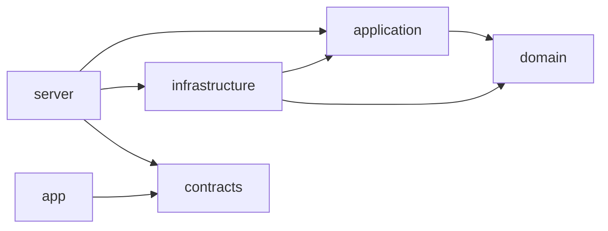

# Başlangıç Kuralları - Her Üye İçin

← [İndeks](../00-index.md) · [Ekip ve yol haritası](../10-ekip-ve-yol-haritasi.md)

Bu doküman hocaya ve ekibe **kim ne yapar, hangi kurallara uyar, nasıl çalışır** özetidir. Her üye baştan sona okur ve imzalar (GitHub issue yorumunda "okudum, anladım" yazar).

---

## 1. Ortak Kurallar (Herkes İçin)

| Kural | Açıklama |
|-------|----------|
| **Kod yazmadan önce plan** | Issue açıklamasını oku → ne yapacağını ve hangi dosyalara dokunacağını yaz → onay al → kodla başla |
| **Küçük PR** | 1 issue = 1 branch = 1 PR. Maksimum 300 satır (test dahil). Büyükse böl. |
| **Test önce** | Kabul testleri (`@Tags(['bekliyor'])`) Hüseyin Emre yazdı. Sen implement et, yeşile çevir, etiketi kaldır. Testi **değiştirme**. |
| **CI yeşil olmadan merge yok** | `dart format`, `dart analyze --fatal-infos`, mimari test, tüm paket testleri yeşil olmalı. |
| **CODEOWNER onayı** | Değiştirdiğin paketin sahibi onaylamazsa merge edilmez. |
| **Kendi hesabınla commit** | Başkası adına commit atma. Hoca GitHub geçmişinden kimin ne yaptığını görür. |
| **Her hafta en az 1 PR** | Boş geçilemez. Küçük olsa bile anlamlı bir şey birleştir. |
| **Günlük rapor** | Çalıştığın her gün `ekip/raporlar/<github-username>/YYYY-AA-GG.md` yaz. Şablon: `Templates/gunluk-rapor.md`. |
| **30 dakika kuralı** | Takılırsan issue'a ne denediğini yaz, yardım iste. |
| **Sır/gerçek veri yok** | `.env`, şifre, token, öğrenci verisi repo'ya girmez. |
| **AI kullanım serbest, anlamadan almak yasak** | Çıktıyı oku, doğrula, anla. PR şablonunda "ne sordum, neyi değiştirdim, neyi anlamadım" yaz. |
| **Anlatabilme kontrolü** | PR review'de en az bir "bu satır neden böyle?" sorusu sorulur, sen cevaplarsın. Hoca sorduğunda anlatabilmelisin. |

---

## 2. Kişiye Özel Kurallar

### 🔴 Hüseyin Emre (@HuseyinEmreTech) - Teknik Lider
**Paketler:** `domain`, `application`, `contracts`, `test/`, `.github/`, `AGENTS.md`, CI
**Sorumluluk:** Mimari kararlar, domain kuralları (Rule 00-07), kabul testleri, PR incelemesi, GitHub düzeni

| Kurallar | Detay |
|----------|-------|
| **Domain/App/Contracts sahibidir** | Bu 3 pakete başkası dokunamaz (CODEOWNER). Sadece sen onaylarsın. |
| **Kabul testleri sen yazarsın** | Her kural/USR için `@Tags(['bekliyor'])` testleri görevden önce yaz. |
| **Mimari kararı sen verirsin** | ADR taslağı herkes önerebilir, final sen onaylarsın. |
| **PR incelemesi sen yaparsın** | Tüm PR'larda en az 1 "neden böyle?" sorusu sor. |
| **Haftalık kayıt sen derlersin** | Pazar günü birleşen PR'lardan `haftalik/` dosyasını güncelle. |
| **Kod yazma miktarı** | Domain/App/Contracts senin; Infrastructure/Server/App review odaklı. |

---

### 🔵 Ertuğrul Pekdemir (@ertrlpkdmr) - Backend Infrastructure
**Paket:** `infrastructure`, `db/`, `compose.yaml`
**Sorumluluk:** PostgreSQL repository'ler, dosya depolama, EXIF temizleme, migration, Docker

| Kurallar | Detay |
|----------|-------|
| **Sadece `infrastructure` paketine yazarsın** | Domain/App/Contracts import **yok** (sadece interface implement). |
| **`dart:io` serbest** | Sadece infrastructure paketinde. Diğer paketlerde yasak. |
| **SQL parametreli** | `$1`, `$2` ile yaz. String interpolation **yasak**. |
| **Migration elle** | `db/migrations/V{N}__<ad>.sql` sıralı. ORM yok. |
| **Hüseyin Emre ile pair** | Repository interface hazır → sen implement et. Rule 02 SQL'si kritik. |
| **FileStorage interface** | Application'da tanımlı, sen implement edersin. |

---

### 🟢 Çağdaş Kemal Ağca (@Cagdas3307) - Backend API / Server
**Paket:** `server`
**Sorumluluk:** Shelf endpoint'ler, auth (JWT), hata eşleme, middleware, OpenAPI

| Kurallar | Detay |
|----------|-------|
| **Sadece `server` paketine yazarsın** | Tüm paketleri import edebilirsin (composition root). |
| **İş kuralı yazmazsın** | Kural `domain`/`application`dadır. Sen sadece HTTP'e çevirirsin. |
| **Hata eşleme `switch` ile** | `AppError` sealed class → HTTP status. Yeni hata eklenince derleyici uyarır. |
| **Auth middleware** | JWT verify, role guard (`Staff`/`Student`). Token refresh rotation. |
| **Contract DTO kullan** | Request/Response `campus_contracts` paketinden gelir. Elle JSON yazma. |
| **Rate limit / güvenlik başlıkları** | Senin sorumluluğun. |

---

### 🟡 Yusuf Ekenel (@yusufekenel) - Flutter Mobil (Android/iOS/Web)
**Paket:** `app` (mobil odaklı)
**Sorumluluk:** Öğrenci ve görevli mobil ekranları, platform kanalları (kamera, konum)

| Kurallar | Detay |
|----------|-------|
| **Sadece `app` paketine yazarsın** | **Yalnızca** `campus_contracts` import edebilirsin. Domain/App/Infra **yasak**. |
| **İş kuralı ekranda yazma** | Validation server'da. Client sadece UX için basit kontrol. |
| **Paylaşılan widget'lar** | `PhotoPicker`, `LocationPicker`, `CategorySelector` → Fatma ile **ortak**. |
| **State management** | `ChangeNotifier` + `ListenableBuilder`. Riverpod/Bloc **yok**. |
| **JSON elle** | `fromJson`/`toJson` elle yaz. `json_serializable` **yok**. |
| **Platform kanalları** | Kamera, konum, izinler Flutter plugin'leriyle. Native kod yazma. |

---

### 🟣 Fatma Müberra Yener (@muberrayener) - Flutter Web / Test & QA
**Paket:** `app` (web odaklı), test stratejisi
**Sorumluluk:** Responsive web, widget/E2E test, SonarQube, CI kalite

| Kurallar | Detay |
|----------|-------|
| **Web responsive** | Mobile (<600px), Tablet (600-900px), Desktop (>900px) - `LayoutBuilder` ile. |
| **Paylaşılan widget'lar** | Yusuf ile **aynı dosyaları** kullanırsınız (copy-paste yok). |
| **Test sahibidir** | Unit/Widget/Contract/Integration/E2E stratejisi senin. |
| **SonarQube Cloud** | Kurulum, quality gate, tarama senin. Dart için Cloud Free plan. |
| **PWA/SEO** | `manifest.json`, service worker, meta tags web'e özgü. |
| **Cross-browser test** | Chrome, Firefox, Safari (hafta 14). |

---

### 🟠 Emir Kerem Çakıcı (@KeremC23) - Esnek Destek / Test & Kalite
**Paket:** `test/` (genel), dokümantasyon, yardımcı geliştirme
**Sorumluluk:** Kabul testleri yeşile çevirme, entegrasyon/E2E test, hata takibi, dokümantasyon

| Kurallar | Detay |
|----------|-------|
| **Esnek rol** | Takıma göre değişir. İlk 2 hafta öğrenme + pair programming. |
| **Test odaklı** | Kabul testleri (`bekliyor` etiketli) yeşile çevirmek **önceliğin**. |
| **Test değiştirmezsin** | Sadece implementation yazarsın, `@Tags(['bekliyor'])` etiketini kaldırırsın. |
| **Pair programming zorunlu** | Anlamadığın her yerde Hüseyin Emre / Ertuğrul / Çağdaş ile 1-2 saat pair. |
| **30 dakika kuralı senden başlar** | Takılma → issue'a yaz →pair iste. |
| **Küçük task'lar** | PR review yardımı, dokümantasyon düzeltme, flaky test düzeltme. |

---

## 3. Paket Bağımlılık Matrisi (Unutma)



| Paket | İçine Yazan | İçine Yazmayan |
|-------|-------------|----------------|
| `domain` | **Sadece Hüseyin** | Herkes (import bile etmez) |
| `application` | **Sadece Hüseyin** | Ertuğrul, Çağdaş, Yusuf, Fatma, Emir |
| `contracts` | **Sadece Hüseyin** | Herkes import eder (DTO için) |
| `infrastructure` | **Sadece Ertuğrul** | Diğerleri |
| `server` | **Sadece Çağdaş** | Diğerleri |
| `app` | **Yusuf (mobil), Fatma (web)** | Hüseyin, Ertuğrul, Çağdaş, Emir |

---

## 4. Git / Branch / PR Şablonu

### Branch Adı
```
feature/hafta05-<kisa-ad>     # Yeni özellik
fix/hafta05-<kisa-ad>         # Hata düzeltme
test/hafta05-<kisa-ad>        # Test ekleme
docs/hafta05-<kisa-ad>        # Dokümantasyon
```

### Commit Mesajı
```
feat: uygulama usecase'leri create, assign, resolve, list eklendi
fix: report repository race condition sql düzeltildi
test: rule02 kabul testi yeşile çevrildi
docs: api tasarımı güncellendi
refactor: file storage interface ayrıldı
chore: ci workflow guncellendi
```

### PR Açıklaması (Şablon - `.github/pull_request_template.md`)
1. **Ne yaptım** (2-3 cümle)
2. **Nasıl test ettim** (komutlar, ekran görüntüsü)
3. **Yapay zeka kullanımı** (araç, ne sordum, neyi değiştirdim, neyi anlamadım)
4. **Doküman** (hangi dosya güncellendi / gerekmedi)
5. **Kontrol** (sadece issue dosyaları, sır yok, anlatabilirim)

---

## 5. Haftalık İş Akışı

| Gün | Aktivite |
|-----|----------|
| **Pazartesi** | 15 dk online planlama → issue'lar atanır, branch'ler açılır |
| **Salı-Çarşamba** | Kod yazma, test, commit, push |
| **Perşembe** | PR açma, review isteği, CI bekleme |
| **Cuma** | **Ders**: 1 dk/kişi demo (ne merge edildi, ne bloklandı) |
| **Cumartesi-Pazar** | Review yanıtlama, merge, sonraki hafta hazırlığı |
| **Not (1 Kasım 2026)** | Bu haftalık akış ve Pazar kapanışı kaldırıldı; güncel düzen: [Kalan işler planı](../planlar/2026-11-01-kalan-isler.md) |

---

## 6. Onay

Bu kuralları okudum, anladım ve uygulayacağım.

| Üye | GitHub | Onay (Issue yorumunda "okudum" yaz) |
|-----|--------|--------------------------------------|
| Hüseyin Emre | @HuseyinEmreTech | ⬜ |
| Ertuğrul Pekdemir | @ertrlpkdmr | ⬜ |
| Çağdaş Kemal Ağca | @Cagdas3307 | ⬜ |
| Yusuf Ekenel | @yusufekenel | ⬜ |
| Fatma Müberra Yener | @muberrayener | ⬜ |
| Emir Kerem Çakıcı | @KeremC23 | ⬜ |

---

**Not:** Bu kurallar proje boyunca geçerlidir. Değişiklik önerisi için issue aç, takım onayı al, sonra güncelle.