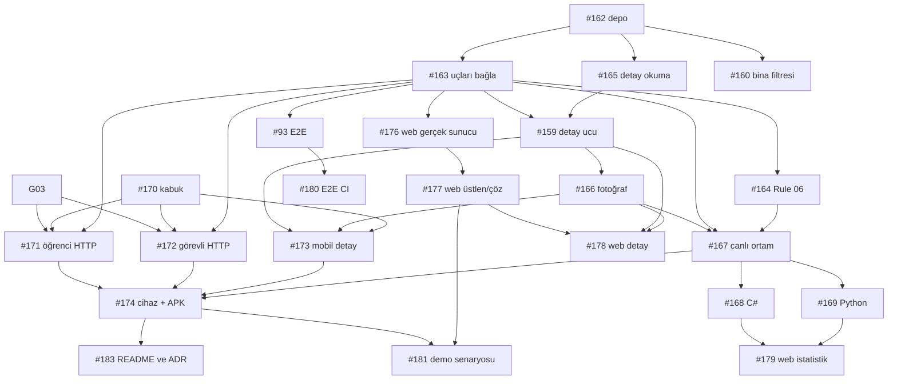

# Kalan İşler ve Görev Dağılımı: Uygulama Planı

← [İndeks](../00-index.md) · [Ekip ve yol haritası](../10-ekip-ve-yol-haritasi.md)

> **Yapay zeka ile uygulayanlar için:** Bu planı görev görev uygula (`superpowers:executing-plans` veya `superpowers:subagent-driven-development`). Adımlar `- [ ]` ile işaretlidir.

**Hedef:** Parçaları `main`'de duran ürünü uçtan uca çalışır hâle getirmek: öğrenci telefondan bildirim açar, görevli üstlenip çözer, öğrenci haberi alır.

**Mimari:** Yeni bileşen yok. Hazır parçalar birbirine bağlanır: rapor uçları `bin/server.dart`'a, mobil ekranlar gerçek HTTP kaynaklarına, web istemcisi gerçek sunucuya, servisler compose'a.

**Teknoloji:** Dart/Shelf, PostgreSQL 16, Flutter (Android), HTML/JS, FastAPI, .NET, pytest, Docker Compose.

**Spec:** [Kapsam](../01-project-scope.md), [Domain](../03-domain-design.md), [Hikayeler](../04-user-stories.md), [API](../05-api-design.md), [Korumalar](../11-kod-mimarisi-ve-korumalar.md), [ADR-04](../adr/04-cok-dilli-web-ve-servisler.md).

## Çalışma düzeni

**Son tarih yok.** Vize dönemi nedeniyle görevler haftaya bağlanmadı; milestone ve `[Hafta NN]` öneki kullanılmaz. Sırayı yalnızca bağımlılık belirler: bir görevin bağımlılıkları birleştiyse başlanabilir. Sınavı olan yoğunluğuna göre alır; yapamayacak olan issue'ya yazar, görev başkasına geçer.

## Durum tespiti (1 Kasım 2026)

| Alan | Durum | Eksik |
| --- | --- | --- |
| Domain, application | Use case'ler ve kabul testleri tamam | Rule 06'nın kampüs sınırı hiçbir katmanda denetlenmiyor; `CampusBoundsConfig` kullanılmıyor |
| Infrastructure | Depolar, EXIF, 5 MB tamam | #162 incelemede; `findById` durum geçmişi taşımıyor |
| Server | Auth, bina, bildirim, kullanıcı uçları canlı | **`ReportEndpoints`, `ReportCreationEndpoint`, `ReportResolutionEndpoint` yazıldı ama `bin/server.dart`'a bağlı değil**; detay ucu ve `/files` yok |
| Contracts | Boş paket | DTO yok |
| Mobil | Ekranlar ve testler tamam | **Uygulama açılışı yer tutucu**; HTTP kaynağı hiç yok, ekranlar yalnızca sahte veriyle çalışıyor |
| Web (HTML/JS) | Giriş, liste, filtre | Gerçek sunucuda denenmedi; üstlen, çöz, detay yok |
| Python, C# | Servis ve testler tamam | Compose'da yok; C# testleri CI'da çalışmıyor |
| E2E | İskelet hazır | Testler `xfail`; CI'da çalışmıyor |
| Dağıtım | `compose.prod.yaml` var | Uçtan uca denenmedi; HTTPS yok |

## Kararlar

Bu plan aşağıdaki kararlarla yazıldı; teknik lider onayıyla kesinleşir.

| Karar | Gerekçe |
| --- | --- |
| Web yüzeyi HTML/JS istemcisidir (`web/`). `lib/web/` Flutter Web kodu dondurulur, yeni iş açılmaz | İki web istemcisini yetiştirecek kapasite yok. ADR-04'teki açık soruyu kapatır |
| `campus_app` HTTP için `http` paketini kullanır | `dart:io HttpClient` ile multipart elle yazılmak zorunda kalır. Paket eklendiği PR'da [teknoloji kaydına](../kayitlar/teknoloji-degisiklikleri.md) girer |
| `campus_contracts` yalnızca istemcinin okuduğu yanıtları içerir | Sunucu mapper'ları çalışıyor; yeniden bağlamak kazanç getirmez. Sözleşme uyumunu E2E testleri korur; [kod mimarisi](../11-kod-mimarisi-ve-korumalar.md) buna göre güncellendi |
| Mobilde demo backend silinir | Yedek plan yerel sunucudur; teslimde sahte veri yolu kalmaz |
| HTTPS: VPS varsa Caddy; yoksa demo yerel ağda, geliştirme derlemesiyle ve README'de açıkça yazılarak | #21'deki soruyu yanıtlar; [10-ekip bölüm 3](../10-ekip-ve-yol-haritasi.md) ile uyumlu |
| Fotoğraf okuma: öğrenci yalnızca kendi bildiriminin fotoğrafını, görevli hepsini görür | Rule 01 ve [güvenlik dokümanı](../06-security-and-privacy.md); adresin tahmin edilemez olması yetki yerine geçmez |

## Görev dağılımı

| Kişi | Görevler |
| --- | --- |
| Hüseyin Emre (`HuseyinEmreTech`) | #94, #164, #183; #162 ve PR incelemeleri |
| Çağdaş Kemal Ağca (`Cagdas3307`) | #163, #159, #168 |
| Ertuğrul Pekdemir (`ertrlpkdmr`) | #165, #160, #166, #167 |
| Yusuf Ekenel (`yusufekenel`) | #170, #171, #173, #174 |
| Fatma Müberra Yener (`muberrayener`) | #172, #169, #182 |
| Murat Yaman (`yamanmurat761`) | #175, #176, #177, #178, #179 |
| Emir Kerem Çakıcı (`KeremC23`) | #93, #180, #181 |

## Bağımlılık sırası

Hemen başlanabilir: #162 incelemesi, #94, #170, #175.

## Global kurallar

Her görev için geçerlidir; görevlerde tekrar edilmez.

- [AGENTS.md](../../AGENTS.md) geçerlidir: paket sınırları, `Result` dönüşü, `default`'suz `switch`, parametreli SQL, sihirli sayı yok, elle `fromJson`/`toJson`, `print` yok.
- Değişmez değerler: fotoğraf en fazla 5 MB ve yalnızca jpeg/png; açıklama 5-500 karakter; `pageSize` varsayılan 20, en fazla 100; rol adları `Student`, `Staff`; durumlar `Yeni`, `Ustlenildi`, `Cozuldu`; hata biçimi `{ "error": { "code", "message", "details" } }`.
- Yeni dış paket yalnızca bu planda adı geçense eklenir; değilse issue'da sorulur.
- Branch: `feature/<issue-no>-<kisa-ad>` (test işinde `test/`, doküman işinde `docs/`). PR `Closes #<issue-no>` içerir. Birleştirmeden önce `scripts/pr-birlesme-kontrolu.sh` çalıştırılır.

**Her görevin adımları:**

- [ ] Görevdeki testleri yaz ve kırmızı olduklarını gör.
- [ ] En küçük kodu yaz, testleri yeşile çevir.
- [ ] `dart format .`, `dart analyze --fatal-infos` ve ilgili paketin testlerini çalıştır.
- [ ] Davranış değiştiyse ilgili dokümanı aynı PR'da güncelle; günlük raporunu yaz.
- [ ] PR aç; inceleyenin "bu satır neden böyle?" sorusunu kendi cümlenle yanıtla.

## Dikkat edilecekler

Spec'in açıkça söylemediği ama kullanıcıyı ilk vuracak durumlar; her birinin testi sahibi olan görevdedir.

1. **Süresi dolan erişim belirteci:** istek bir kez yenilenip tekrarlanır; yenileme de başarısızsa kullanıcı girişe döner, form verisi sessizce kaybolmaz (#170).
2. **Başka öğrencinin bildirimi:** adresini veya fotoğraf adresini bilse de `404` alır, varlığı sızmaz (#159, #166).
3. **Sunucunun reddettiği fotoğraf:** `400`/`413` ekranda okunur bir mesaj olur, seçili form korunur (#171).
4. **Aynı anda üstlenme:** ikinci görevli `409` alınca "başkası üstlendi" görür ve liste tazelenir (#172, #177).
5. **Konteyner yeniden başlaması:** yüklenen fotoğraf `files` diskinden okunmaya devam eder (#167). Web'de `` Bearer başlığı gönderemediği için fotoğraf `fetch` ile alınır (#178).

---

## Görevler

### #163 Rapor uçlarını sunucuya bağla
**Sahip:** `Cagdas3307` · **Etiket:** `server`, `feat`, `sart` · **Bağımlı:** #162

**Amaç.** Çalışan sunucuda bildirim açılabilir, listelenebilir, üstlenilebilir ve çözülebilir. Şu an bu uçlar yazılı ama `bin/server.dart`'a bağlı olmadığı için `404` dönüyor.

**Kabul ölçütü.**
- `ReportEndpoints`, `ReportCreationEndpoint`, `ReportResolutionEndpoint` korumalı `Cascade`'e eklenir; depo olarak `PostgresReportRepository` kullanılır.
- Fotoğraf klasörü adlandırılmış ortam değişkeninden (`FILES_DIR`) okunur; `compose.prod.yaml`'de `/data/files`, `.env.example`'da da tanımlıdır. Tanımsızsa sunucu, JWT sırlarındaki gibi günlüğe yazıp açılmaz.
- Testler: girişsiz `GET /api/reports` `401` döner (`404` değil); öğrenci `GET /api/reports` `403` alır. Doğrulama `test/e2e` ile gerçek sunucuya karşı yapılır (bkz. #93).

**Dokunulacak.** `packages/server/bin/server.dart`, `compose.prod.yaml`, `.env.example`, `README.md` (çalıştırma bölümü).

**Dokunulmayacak.** `packages/domain`, `packages/application`, `packages/contracts`, `test/`, `.github/`.

**Okunacaklar.** [API](../05-api-design.md); #162 açıklaması.

### #164 Rule 06: kampüs dışı bildirimi reddet
**Sahip:** `HuseyinEmreTech` · **Etiket:** `application`, `feat`, `sart` · **Bağımlı:** #163

**Amaç.** Kampüs dışından açılan bildirim `422 OUTSIDE_CAMPUS` ile reddedilir. Rule 06'nın bu yarısı şu an hiçbir katmanda yok; `CampusBoundsConfig` hazır ama kullanılmıyor.

**Kabul ölçütü.**
- `ReportCreateUseCase(repository, clock, bounds)`; `bounds` güney-batı ve kuzey-doğu koordinatlarını taşıyan değer. Application paketi `campus_infrastructure` içe aktarmaz; sunucu, `CampusBounds`'u bu değere çevirir.
- Kabul testleri: `gpsOutsideBounds_isRejected`, `gpsOnBoundary_isAccepted`, `gpsInsideBounds_isAccepted`.
- `exception_mapper.dart` hatayı `422 OUTSIDE_CAMPUS` yapar; `switch`'te `default` yok.
- `CAMPUS_*` değerleri eksikse sunucu açılmaz; değerler `compose.prod.yaml`'e eklenir. Gerçek koordinatlar için `00-index.md` "Kampüs sınırı" satırı güncellenir.

**Dokunulacak.** `packages/domain` (gerekirse hata türü), `packages/application`, `packages/server/lib/src/exception/exception_mapper.dart`, `packages/server/bin/server.dart`, `compose.prod.yaml`, `proje-bilgileri/05-api-design.md`, `proje-bilgileri/00-index.md`.

**Dokunulmayacak.** `packages/app`, `web/`, `services/`.

**Okunacaklar.** [Domain](../03-domain-design.md) Rule 06; `packages/infrastructure/lib/src/config/campus_bounds_config.dart`.

### #94 contracts: istemcinin okuduğu yanıt DTO'ları
**Sahip:** `HuseyinEmreTech` · **Etiket:** `contracts`, `feat`, `sart` · **Bağımlı:** yok

**Amaç.** `campus_contracts` boş paket olmaktan çıkar; mobil yanıtları bu sınıflarla okur. Kapsam daraltıldı: sunucu mapper'ları yeniden bağlanmaz, deploy #167'e taşındı.

**Kabul ölçütü.**
- Elle `fromJson`/`toJson` ile: `AuthResponseDto`, `ReportListItemDto`, `ReportDetailDto`, `StatusChangeDto`, `PageDto<T>`, `NotificationDto`, `BuildingDto`, `ApiErrorDto`. Alan adları `05-api-design.md` ile birebir.
- Eksik veya yanlış tipli alan istisna fırlatmaz, `null` döner.
- Testler: her DTO için `fromJson_readsApiExample` (API dokümanındaki örnek), `fromJson_returnsNull_onMissingField`.

**Dokunulacak.** `packages/contracts/`, `proje-bilgileri/05-api-design.md` (gerekirse).

**Dokunulmayacak.** `packages/server`, `packages/app`.

**Okunacaklar.** [API](../05-api-design.md); #159.

### #165 Bildirim detayını durum geçmişiyle okuma
**Sahip:** `ertrlpkdmr` · **Etiket:** `infrastructure`, `feat`, `sart` · **Bağımlı:** #162

**Amaç.** #159'in ihtiyaç duyduğu tek okuma: bildirim, bina adı ve durum geçmişi. `findById` yalnızca `Report` döndürüyor; `findHistory` ise arayüzde yok.

**Kabul ölçütü.**
- `ReportRepository`'ye `Future<Result<ReportDetailView?, AppError>> findDetail(ReportId reportId)` eklenir.
- `ReportDetailView { Report report; String? buildingName; List<ReportStatusChange> history; }`, `ReportStatusChange { ReportStatus status; DateTime changedAt; String? note; }` application paketinde tanımlanır; `FakeReportRepository` de uygular.
- Gerçek veritabanı testleri: `findDetail_returnsHistoryInOrder`, `findDetail_returnsBuildingName`, `findDetail_returnsNull_whenMissing`.

**Dokunulacak.** `packages/application/lib/src/repository/`, `packages/application/lib/src/dto/`, `packages/application/test/support/fake_report_repository.dart`, `packages/infrastructure/lib/src/repository/postgres_report_repository.dart` ve testi.

**Dokunulmayacak.** `packages/server`, `packages/app`, `web/`.

**Okunacaklar.** #159; `ReportRepositoryImpl.findHistory`.

### #159 GET /api/reports/{id} bildirim detay ucu
**Sahip:** `Cagdas3307` · **Etiket:** `server`, `feat`, `sart` · **Bağımlı:** #163, #165 · **Mevcut issue:** #159

**Amaç.** Mobil ve web detay ekranı gerçek veriyi, durum geçmişini ve çözüm sonucunu görür.

**Kabul ölçütü.**
- `GetReportUseCase.execute({reportId, currentUserId, role})` → `Result<ReportDetailView, AppError>`. Öğrenci yalnızca kendi bildirimini görür (Rule 01); görevli hepsini.
- Yanıt alanları: `reportId, category, description, status, place, buildingName, photoUrl, createdAt, history[{status, changedAt, note}]`; çözüldüyse `resolutionPhotoUrl, resolutionNote`.
- Testler: `student_seesOwnReport`, `student_gets404_forOthersReport`, `staff_seesAnyReport`, `malformedId_returns404`, `missing_returns404`, `resolved_includesResolutionFields`, `anonymous_returns401`.
- `05-api-design.md` ve `openapi.yaml` güncellenir.

**Dokunulacak.** `packages/application/lib/src/usecase/`, `packages/application/test/`, `packages/server/lib/src/endpoint/report_endpoints.dart`, `packages/server/lib/src/mapper/report_mapper.dart`, `packages/server/bin/server.dart`, `packages/server/test/`, `packages/server/openapi.yaml`, `proje-bilgileri/05-api-design.md`.

**Dokunulmayacak.** `packages/domain`, `packages/contracts`, `packages/app`, `web/`.

**Okunacaklar.** #159; [Domain](../03-domain-design.md) Rule 01.

### #160 GET /api/reports bina filtresi
**Sahip:** `ertrlpkdmr` · **Etiket:** `infrastructure`, `server`, `feat`, `olmali` · **Bağımlı:** #162 · **Mevcut issue:** #160

**Amaç.** Web istemcisinin gönderdiği `buildingId` filtresi çalışır.

**Kabul ölçütü.**
- `ListReportsQuery` ve `ReportListFilter`'a `buildingId` eklenir; SQL parametreli kalır, toplam sayı aynı süzgeçle hesaplanır.
- Testler: `list_filtersByBuilding`, `list_totalMatchesBuildingFilter`, `invalidBuildingId_returns400`, `student_cannotUseStaffList_withBuildingId`.
- `05-api-design.md` "öneri" notu kaldırılır; `openapi.yaml` güncellenir.

**Dokunulacak.** `packages/application/lib/src/dto/list_reports_query.dart`, `packages/application/lib/src/repository/report_list_filter.dart`, `packages/application/lib/src/usecase/list_reports_usecase.dart`, `packages/infrastructure/lib/src/repository/`, `packages/server/lib/src/endpoint/report_endpoints.dart`, ilgili testler, `packages/server/openapi.yaml`, `proje-bilgileri/05-api-design.md`.

**Dokunulmayacak.** `packages/domain`, `web/`, `packages/app`.

**Okunacaklar.** #160; `web/js/api.js`.

### #166 Fotoğraf sunumu: GET /files
**Sahip:** `ertrlpkdmr` · **Etiket:** `server`, `infrastructure`, `feat`, `sart` · **Bağımlı:** #159

**Amaç.** `photoUrl` ve `resolutionPhotoUrl` yalnızca görmeye yetkili kişiye açılır. Şu an adres kaydediliyor ama bu adresi sunan bir uç yok.

**Kabul ölçütü.**
- Korumalı `GET /files/<reportId>/<ad>`; dosyayı `LocalFileStorage.openRead` ile akıtır, belleğe almaz. Geçersiz biçimli veya olmayan adres `404`.
- Yetki Rule 01'e uyar: adresteki `reportId` ile #159'daki `GetReportUseCase` çağrılır; öğrenci yalnızca kendi bildiriminin, görevli her bildirimin fotoğrafını görür. Kural kullanım senaryosundadır, uçta yeniden yazılmaz.
- Adres, o bildirimin `photoUrl` veya `resolutionPhotoUrl` değeri değilse `404`. Yetkisiz istek de `404` alır; dosyanın varlığı sızmaz.
- `Content-Type` uzantıdan (`image/jpeg`, `image/png`); `Cache-Control: private`.
- Testler: `file_returnsBytesAndContentType`, `anonymous_returns401`, `missing_returns404`, `pathTraversal_returns404` (`/files/../../etc/passwd` ve kodlanmış hâli), `student_readsOwnPhotos`, `student_gets404_forOthersPhoto`, `staff_readsAnyPhoto`, `urlNotBelongingToReport_returns404`.
- `05-api-design.md` ve `06-security-and-privacy.md` bu yetki kuralıyla güncellenir.

**Dokunulacak.** `packages/server/lib/src/endpoint/file_endpoints.dart` (yeni), `packages/server/bin/server.dart`, `packages/server/test/endpoint/`, `packages/server/openapi.yaml`, `proje-bilgileri/05-api-design.md`, `proje-bilgileri/06-security-and-privacy.md`.

**Dokunulmayacak.** `packages/domain`, `packages/application`, `packages/app`, `web/`.

**Okunacaklar.** `packages/infrastructure/lib/src/storage/local_file_storage.dart`.

### #167 Canlı ortamı uçtan uca çalıştır (compose + HTTPS)
**Sahip:** `ertrlpkdmr` · **Etiket:** `infrastructure`, `ci`, `feat`, `sart` · **Bağımlı:** #163, #164, #166

**Amaç.** `docker compose -f compose.prod.yaml up -d --build` ile sıfırdan ayağa kalkan sistem demo için hazırdır. #94'ün deploy kısmı buraya taşındı; #21'deki HTTPS sorusunun yanıtı burada uygulanır.

**Kabul ölçütü.**
- Boş veritabanıyla açılışta migration ve seed çalışır, `/health` `200` döner, `test/e2e` geçer.
- Konteyner yeniden başlatılınca yüklenen fotoğraf hâlâ açılır.
- Caddy, isteğe bağlı compose profili olarak eklenir (`Caddyfile` birkaç satır; 6 MB üstü istek sunucuya ulaşmaz). VPS yoksa yerel ağ demosu README'de adım adım yazılır.
- Demo adresi #174'e yorum olarak yazılır (Yusuf `--dart-define=API_URL` ile kullanır).

**Dokunulacak.** `compose.prod.yaml`, `Caddyfile` (yeni), `db/prod/`, `README.md`, `proje-bilgileri/kayitlar/teknoloji-degisiklikleri.md`.

**Dokunulmayacak.** `packages/`, `web/`, `services/`.

**Okunacaklar.** README bölüm 10; #21 yorumları; `ekip/raporlar/ertrlpkdmr/2026-10-18.md`.

### #168 C# servisi: CI ve compose
**Sahip:** `Cagdas3307` · **Etiket:** `ci`, `olmali` · **Bağımlı:** #167

**Amaç.** ADR-04'ün "her servis kendi CI işi ve Docker imajıyla gelir" koşulu C# için de sağlanır.

**Kabul ölçütü.**
- `ci.yml`'e `services/rapor-istatistik` için `dotnet test` işi eklenir.
- `compose.prod.yaml`'e `profiles: [servisler]` ile `rapor-istatistik` eklenir; veritabanına salt okunur bağlanır, servis kapalıyken çekirdek etkilenmez.
- Çekirdeğin belirteciyle `GET /api/stats/summary` `200`, öğrenci belirteciyle `403` döndüğü README'deki komutlarla elle doğrulanır.

**Dokunulacak.** `.github/workflows/ci.yml`, `compose.prod.yaml`, `services/rapor-istatistik/README.md`.

**Dokunulmayacak.** `packages/`, `web/`, `services/python-report-service/`.

**Okunacaklar.** [ADR-04](../adr/04-cok-dilli-web-ve-servisler.md); `services/rapor-istatistik/README.md`.

### #169 Python servisi: compose ve gerçek çekirdekle doğrulama
**Sahip:** `muberrayener` · **Etiket:** `ci`, `olmali` · **Bağımlı:** #167

**Amaç.** CSV dışa aktarma gerçek çekirdek API'ye karşı çalışır.

**Kabul ölçütü.**
- `compose.prod.yaml`'e `profiles: [servisler]` ile `python-report-service` eklenir; `CORE_API_BASE_URL` iç ağ adresidir.
- Elle doğrulama: görevli belirteciyle CSV iner ve seed bildirimlerini içerir; öğrenci belirteciyle `403`.
- `buildingId` filtresi (#160) birleştiyse çekirdeğe iletilir; test: `export_forwardsBuildingId`.
- `service-contract.md` güncellenir.

**Dokunulacak.** `compose.prod.yaml`, `services/python-report-service/`.

**Dokunulmayacak.** `packages/`, `web/`, `services/rapor-istatistik/`.

**Okunacaklar.** `services/python-report-service/docs/service-contract.md`.

### #170 Mobil: uygulama kabuğu, API istemcisi, gerçek giriş
**Sahip:** `yusufekenel` · **Etiket:** `app:mobile`, `feat`, `sart` · **Bağımlı:** yok (test sahte `http.Client` ile)

**Amaç.** Uygulama açılınca yer tutucu yerine giriş ekranı gelir; gerçek sunucuya giriş yapılır, role göre öğrenci veya görevli ekranı açılır.

**Kabul ölçütü.**
- `http` paketi eklenir, teknoloji kaydına yazılır.
- `lib/mobil/shared/api/api_client.dart`: `ApiClient({required String baseUrl, required SessionStore sessions, http.Client? client})`; `Future<http.Response> get(String path)`, `putJson(String path, Map<String, Object?> body)`, `send(http.MultipartRequest request)`. Bearer ekler. `API_URL`, `--dart-define` ile gelir.
- `lib/mobil/features/auth/data/http_auth_source.dart`: `HttpAuthSource implements AuthSource`.
- `lib/main.dart` mobil kabuğu açar; `test/widget_test.dart` buna göre güncellenir. Rol `Staff` ise görevli, `Student` ise öğrenci listesi.
- Testler: `addsBearerHeader`, `refreshesOnce_on401_thenRetries`, `logsOut_whenRefreshFails`, `doesNotRefreshTwice_inParallelRequests`, `login_mapsInvalidCredentialsToRejected`, `shell_opensStaffHome_forStaffRole`.

**Dokunulacak.** `packages/app/pubspec.yaml`, `packages/app/lib/main.dart`, `packages/app/lib/mobil/shared/api/`, `packages/app/lib/mobil/features/auth/data/`, `packages/app/test/`, `proje-bilgileri/kayitlar/teknoloji-degisiklikleri.md`.

**Dokunulmayacak.** `packages/domain`, `packages/application`, `packages/server`, `packages/app/lib/web/`.

**Okunacaklar.** [API](../05-api-design.md) giriş ve yenileme; `packages/app/lib/mobil/features/auth/`.

### #171 Mobil: öğrenci HTTP kaynakları ve konum alanı
**Sahip:** `yusufekenel` · **Etiket:** `app:mobile`, `feat`, `sart` · **Bağımlı:** #163, #94, #170

**Amaç.** Öğrenci gerçek sunucuda bildirimlerini görür, fotoğraf ve konumla bildirim açar (USR 01, 02).

**Kabul ölçütü.**
- `HttpReportsSource implements ReportsSource` (`GET /api/me/reports`, sayfalı), `HttpReportCreator implements ReportCreator` (multipart `POST /api/reports`), bina kaynağı (`GET /api/buildings`).
- Hazır `LocationField` oluşturma ekranına bağlanır: GPS; izin yoksa bina listesi.
- Testler: `create_sendsMultipartFields`, `create_mapsOutsideCampus422ToRejected`, `create_shows400And413Message_andKeepsForm`, `list_parsesPage`, `createScreen_requiresLocation`.

**Dokunulacak.** `packages/app/lib/mobil/features/reports/data/`, `packages/app/lib/mobil/features/reports/presentation/student/report_create_screen.dart`, `packages/app/lib/mobil/shared/location/`, `packages/app/test/mobil/`.

**Dokunulmayacak.** `presentation/staff/`, `lib/web/`, `packages/server`.

**Okunacaklar.** [USR 01, 02](../04-user-stories.md); `POST /api/reports` örneği.

### #172 Mobil: görevli ve bildirim HTTP kaynakları
**Sahip:** `muberrayener` · **Etiket:** `app:mobile`, `feat`, `sart` · **Bağımlı:** #163, #94, #170

**Amaç.** Görevli gerçek listeyi görür, üstlenir, çözer; öğrenci "çözüldü" bildirimini alır (USR 03-06). Yusuf'un yükü bölünsün diye bu parça ayrıldı.

**Kabul ölçütü.**
- `HttpStaffReportsSource`, `HttpReportAssigner`, `HttpReportResolver` (multipart `resolutionPhoto`, `note`), `HttpNotificationsSource` hazır arayüzleri uygular.
- Görevli listesi `ReportPager` ile sayfalanır.
- Testler: `assign_maps409ToAlreadyTaken`, `staffList_refreshes_after409`, `resolve_sendsPhotoAndNote`, `resolve_mapsInvalidTransition`, `notifications_markRead_returnsFalse_onError`, `staffList_loadsNextPage`.

**Dokunulacak.** `packages/app/lib/mobil/features/reports/data/`, `packages/app/lib/mobil/features/notifications/data/`, `packages/app/lib/mobil/features/reports/presentation/staff/`, `packages/app/test/mobil/`.

**Dokunulmayacak.** `presentation/student/`, `lib/web/`, `packages/server`.

**Okunacaklar.** [USR 03-06](../04-user-stories.md); `report_assigner.dart`, `report_resolver.dart`.

### #173 Mobil: gerçek detay ve fotoğraf gösterimi
**Sahip:** `yusufekenel` · **Etiket:** `app:mobile`, `feat`, `sart` · **Bağımlı:** #159, #166, #170

**Amaç.** Detay ekranı gerçek durum geçmişini ve fotoğrafları gösterir.

**Kabul ölçütü.**
- `HttpReportDetailSource implements ReportDetailSource`.
- Fotoğraflar `Image.network(url, headers: {Authorization})` ile; hata olursa yer tutucu görsel, çökme yok.
- Testler: `detail_parsesHistoryAndResolution`, `detail_maps404ToNotFound`, `photo_showsPlaceholder_onError`.

**Dokunulacak.** `packages/app/lib/mobil/features/reports/data/`, `packages/app/lib/mobil/features/reports/presentation/student/report_detail_screen.dart`, `presentation/student/widgets/report_card.dart`, `packages/app/test/mobil/`.

**Dokunulmayacak.** `lib/web/`, `packages/server`.

**Okunacaklar.** #159; #166.

### #174 Mobil: cihazda uçtan uca deneme, demo backend'i silme, APK
**Sahip:** `yusufekenel` · **Etiket:** `app:mobile`, `feat`, `sart` · **Bağımlı:** #167, #171, #172, #173

**Amaç.** Gerçek Android telefonda USR 01-07 akışı çalışır; demo APK hazırdır.

**Kabul ölçütü.**
- Gerçek telefonda: giriş, kamera, GPS, izin reddinde bina listesi, üstlen, çöz, çözüldü bildirimi denenir; sonuç günlük rapora yazılır.
- `lib/mobil/demo/` ve testi silinir; `grep -r DemoBackend packages/app` boş döner.
- Release APK demo adresiyle derlenir (`--dart-define=API_URL=...`); GitHub Release olarak yayımlanması Hüseyin Emre'ye devredilir.

**Dokunulacak.** `packages/app/lib/mobil/demo/`, `packages/app/test/mobil/demo/`, `packages/app/android/`, `packages/app/README.md`.

**Dokunulmayacak.** `lib/web/`, `packages/server`.

**Okunacaklar.** #167; #21 yorumları.

### #175 SQL incelemesini birleştir, bulguları issue yap
**Sahip:** `yamanmurat761` · **Etiket:** `docs`, `olmali` · **Bağımlı:** yok

**Amaç.** `origin/docs/sql-inceleme` dalında duran inceleme için PR açılmamış; ölçümlü bulgular `main`'e girer.

**Kabul ölçütü.**
- Dal güncel `main`'e taşınır, PR açılır; `00-index.md` bağlantısı çalışır.
- Eyleme dönük her bulgu, Ertuğrul'a atanmış ayrı issue olur; değer uydurulmaz.

**Dokunulacak.** `proje-bilgileri/kayitlar/2026-10-23-sql-inceleme.md`, `proje-bilgileri/00-index.md`.

**Dokunulmayacak.** `db/migrations/`, `packages/`.

**Okunacaklar.** `origin/docs/sql-inceleme`.

### #176 Web: gerçek sunucuya bağla, README'yi düzelt
**Sahip:** `yamanmurat761` · **Etiket:** `app:web`, `fix`, `sart` · **Bağımlı:** #163

**Amaç.** Web istemcisi artık varsayımla değil gerçek sunucuyla çalışır.

**Kabul ölçütü.**
- Seed görevli hesabıyla giriş, liste, durum ve kategori filtresi, sayfalama gerçek sunucuda denenir; sapmalar düzeltilir.
- `tests/index.html` geçer (`data-result="pass"`).
- `web/README.md`: "CORS yok", "endpoint henüz yok" gibi eski varsayımlar temizlenir. Bina filtresi #160 birleşene dek README'de "sunucuda yok" diye kalır.
- Yanıt biçimi farklı çıkarsa `tests/api.test.js`'e sınama eklenir.

**Dokunulacak.** `web/js/`, `web/tests/`, `web/README.md`.

**Dokunulmayacak.** `packages/`, `db/`, `services/`.

**Okunacaklar.** `web/README.md`; [API](../05-api-design.md).

### #177 Web: görevli üstlen ve çöz
**Sahip:** `yamanmurat761` · **Etiket:** `app:web`, `feat`, `sart` · **Bağımlı:** #176

**Amaç.** Görevli web'den bildirim üstlenir ve sonuç fotoğrafıyla çözer (USR 05, 06).

**Kabul ölçütü.**
- `api.js`: `assignReport(id)`, `resolveReport(id, file, note)` (`FormData`, `resolutionPhoto`, `note`).
- Kartta durum ve üstlenene göre düğme; fotoğrafsız çözme formu gönderilmez, istemcide 5 MB ve tür denetimi yapılır (sabitler `config.js`'te).
- Testler (`tests/`): `assign409ShowsTakenMessageAndRefreshes`, `resolveRequiresPhoto`, `resolveRejectsOversizedFile`, `resolveSendsMultipartFields`.

**Dokunulacak.** `web/js/api.js`, `web/js/reports.js`, `web/js/reports-page.js`, `web/js/config.js`, `web/css/style.css`, `web/reports.html`, `web/tests/`.

**Dokunulmayacak.** `packages/`, `db/`, `services/`.

**Okunacaklar.** [USR 05, 06](../04-user-stories.md).

### #178 Web: bildirim detayı ve fotoğraflar
**Sahip:** `yamanmurat761` · **Etiket:** `app:web`, `feat`, `olmali` · **Bağımlı:** #159, #166, #177

**Amaç.** Görevli web'de fotoğrafı, durum geçmişini ve çözüm sonucunu görür.

**Kabul ölçütü.**
- `detail.html` + `js/detail-page.js`. `` Bearer başlığı gönderemediği için fotoğraf `fetch` + `URL.createObjectURL` ile alınır, sayfa kapanınca `revokeObjectURL` yapılır.
- Açıklama ve not `textContent` ile yazılır (`innerHTML` yok).
- Testler: `detailRendersHistory`, `detailEscapesDescription`, `detailShowsNotFound`, `photoRequestSendsBearer`.

**Dokunulacak.** `web/detail.html` (yeni), `web/js/detail-page.js` (yeni), `web/js/api.js`, `web/js/reports.js`, `web/tests/`, `web/README.md`.

**Dokunulmayacak.** `packages/`, `db/`, `services/`.

**Okunacaklar.** #159; #166.

### #179 Web: istatistik kartı ve CSV indirme
**Sahip:** `yamanmurat761` · **Etiket:** `app:web`, `feat`, `olursa` · **Bağımlı:** #168, #169

**Amaç.** C# ve Python servisleri demoda görünür. Vakit kalmazsa ilk kesilecek görev budur.

**Kabul ölçütü.**
- `GET /api/stats/summary` sayıları gösterilir; servis kapalıysa kart gizlenir, sayfa bozulmaz.
- CSV düğmesi `fetch` + blob ile indirir.
- Test: `statsHiddenWhenServiceDown`.

**Dokunulacak.** `web/`.

**Dokunulmayacak.** `packages/`, `services/`.

**Okunacaklar.** İki servisin README ve sözleşmesi.

### #93 E2E: xfail işaretlerini kaldır, testleri gerçek sunucuda geçir
**Sahip:** `KeremC23` · **Etiket:** `test`, `sart` · **Bağımlı:** #163 · **Mevcut issue:** #93

**Amaç.** Kritik akışın gerçek sunucuda çalıştığı testle kanıtlanır.

**Kabul ölçütü.**
- `ENDPOINT_YOK` işareti silinir; `python -m pytest test/e2e -v` yeşildir, atlanan test yoktur.
- Eklenen senaryolar: `test_baska_ogrencinin_bildirimi_404`, `test_cift_cozme_409`, `test_sonuc_fotografsiz_cozulemez`, `test_bes_mb_ustu_foto_reddedilir`.
- Test başarısız olursa test gevşetilmez; sahibine issue açılır.
- `test-rehberi.md` güncellenir, "Taslak" kalkar.

**Dokunulacak.** `test/e2e/`, `test/veri/`, `proje-bilgileri/ekip/test-rehberi.md`.

**Dokunulmayacak.** `packages/`, `web/`, `services/`.

**Okunacaklar.** [Test rehberi](../ekip/test-rehberi.md).

### #180 E2E testlerini CI'a ekle
**Sahip:** `KeremC23` · **Etiket:** `test`, `ci`, `olmali` · **Bağımlı:** #93

**Amaç.** Uçları bozan PR birleşmeden yakalanır.

**Kabul ölçütü.**
- `ci.yml`'de `e2e` işi: PostgreSQL 16 servisi, migration, seed, sunucuyu başlatma (`/health` beklenir), `pytest test/e2e`.
- `conftest.py` CI'da sunucu kapalıysa testi **atlamaz, kırar** (`E2E_ZORUNLU=1`). Bu davranış, kasıtlı olarak sunucusuz çalıştırılıp doğrulanır.
- Sırlar CI'a özel test değerleridir; depoya gerçek sır girmez.

**Dokunulacak.** `.github/workflows/ci.yml`, `test/e2e/conftest.py`, `proje-bilgileri/ekip/test-rehberi.md`, `proje-bilgileri/kayitlar/teknoloji-degisiklikleri.md`.

**Dokunulmayacak.** `packages/`, `web/`, `services/`.

**Okunacaklar.** Mevcut `ci.yml`; [Test rehberi](../ekip/test-rehberi.md).

### #181 Demo senaryosu ve elle kabul turu
**Sahip:** `KeremC23` · **Etiket:** `docs`, `test`, `olmali` · **Bağımlı:** #174, #177

**Amaç.** 10 dakikalık sunuma sığan, denenmiş bir demo vardır. Web ve mobil için otomatik E2E yazılmaz; bu tur onun yerini alır.

**Kabul ölçütü.**
- `proje-bilgileri/ekip/demo-senaryosu.md`: adım adım kim ne yapar, hangi seed hesabı, yedek ekran kaydı nasıl alınır.
- USR 01-07 için geçti/kaldı tablosu: tarih, cihaz, sonuç. Kalan her madde ayrı issue olur.
- Yalnızca sahte kullanıcı ve sahte fotoğraf kullanılır.

**Dokunulacak.** `proje-bilgileri/ekip/demo-senaryosu.md` (yeni), `proje-bilgileri/00-index.md`.

**Dokunulmayacak.** Ürün kodu.

**Okunacaklar.** [Hikayeler](../04-user-stories.md).

### #182 SonarQube bulgularını güncelle
**Sahip:** `muberrayener` · **Etiket:** `ci`, `docs`, `olmali` · **Bağımlı:** yok

**Amaç.** Kalite kaydı 24 Ekim'de kaldı; 40'tan fazla PR sonrası güncel durum kayda girer.

**Kabul ölçütü.**
- `sonarqube-puanlari.md`'ye SonarCloud'dan okunan güncel puan ve kapsam yazılır; değer uydurulmaz.
- Açık her bulgu için düzeltme PR'ı ya da gerekçeli "kabul edildi" satırı. 3 × `dart:S107` (domain) için karar Hüseyin Emre ile issue'da verilir.

**Dokunulacak.** `proje-bilgileri/kayitlar/sonarqube-puanlari.md`; bulguya göre kendi alanındaki kod.

**Dokunulmayacak.** `sonar-project.properties` (kapsam daraltarak puan yükseltilmez).

**Okunacaklar.** [ADR-02](../adr/02-kalite-araci-sonarqube-cloud.md).

### #183 README, ADR ve teslim dokümanları
**Sahip:** `HuseyinEmreTech` · **Etiket:** `docs`, `sart` · **Bağımlı:** #174

**Amaç.** Hocanın baktığı dokümanlar çalışan sistemle aynı şeyi söyler.

**Kabul ölçütü.**
- README: gerçek mimari ve çağrı akışı, kullanılan yapay zeka araçları, zorluklar ve çözümler, doğrulanmış kurulum adımları.
- ADR-04 durumu netleşir; ADR-01 ve ADR-02 "Önerildi" olmaktan çıkar.
- Ekip sayısı tutarlı hâle gelir (`AGENTS.md`: 6, `00-index.md`: 7).
- Hocaya sorulacaklar kapanır: sunum tarihleri ve biçimi, teslim dersi, ADR-02, ADR-04 kapsamı.
- `obsidian vault=proje-bilgileri unresolved`, `orphans`, `deadends` temiz.

**Dokunulacak.** `README.md`, `AGENTS.md`, `proje-bilgileri/`.

**Dokunulmayacak.** Ürün kodu.

**Okunacaklar.** [Kapsam](../01-project-scope.md); ADR'lar.
