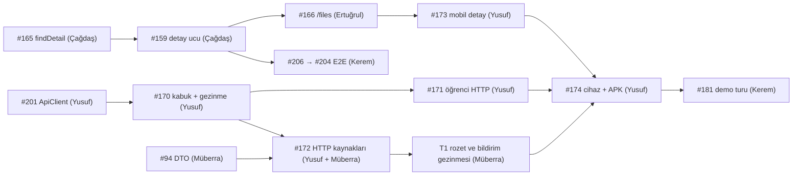

# Teslime Kadar Kalan İşler: Uygulama Planı

← [İndeks](../00-index.md) · Önceki plan: [Kalan işler (1 Kasım)](2026-11-01-kalan-isler.md) · [Ekip ve yol haritası](../10-ekip-ve-yol-haritasi.md)

> **Yapay zeka ile uygulayanlar için:** Bu planı görev görev uygula (`superpowers:subagent-driven-development` önerilir ya da `superpowers:executing-plans`). Adımlar `- [ ]` ile işaretli. Her görev bir issue'dur; issue gövdesi bu plandaki bölümün kopyasıdır.

**Hedef:** Ürünü hocanın teslim ölçütlerini karşılayacak hâle getirmek. Öğrenci telefondan bildirim açar, görevli üstlenip çözer, öğrenci rozet ve haberle öğrenir. Bunun yanında README, ADR'ler, katkı raporu ve sunum hazır olur.

**Mimari:** Yeni bileşen yok. 1 Kasım planındaki issue'lar sürüyor. Bu plan, 24 Kasım taramasında **hiçbir issue'da olmadığı** bulunan işleri ve süreç (teslim) işlerini ekliyor. Ayrıca kritik yolu ve dağılımı güncelliyor.

**Teknoloji:** Dart/Shelf, PostgreSQL 16, Flutter 3.47.0 (Android), HTML/JS, FastAPI, .NET 10, pytest, Docker Compose, Caddy.

**Spec:** [Kapsam](../01-project-scope.md), [Domain](../03-domain-design.md), [Hikayeler](../04-user-stories.md), [API](../05-api-design.md), [Güvenlik](../06-security-and-privacy.md), [ADR-04](../adr/04-cok-dilli-web-ve-servisler.md), [1 Kasım planı](2026-11-01-kalan-isler.md).

## Global kurallar

1 Kasım planındaki global kurallar aynen geçerli: AGENTS.md, değişmez değerler, branch adı, `Closes #`, `scripts/pr-birlesme-kontrolu.sh`. Ek olarak:

- **PR başlığı commit mesajıdır.** Repo yalnızca squash birleştirmeye izin veriyor, bu yüzden başlık Türkçe ve önekli olmalı (`feat:`, `fix:`, `test:`, `docs:`). Dal adı başlık olmaz.
- **Her PR açıklamasında yapay zeka beyanı olur:** araç, model, kullanılan skill'ler, çalıştırılan araçlar, geliştirme ortamı, AI çıktısında neyi değiştirdiğin. "Neyi değiştirdim: yok" yazılmaz; gerçek bir müdahale ya da öğrenilen nokta yazılır.
- **Haftalık ritim:** her üyenin **her hafta en az bir PR'ı birleşir.** Neden: hoca GitHub geçmişine bakıyor ve squash yüzünden `main`'deki commit sayısı birleşen PR sayısına eşit. 3 Kasım'dan 24 Kasım'a kadar `main` boş kaldı.
- **Özellik dondurma: Pazar 6 Aralık.** Bu tarihten sonra yalnızca `fix:`, `test:` ve `docs:` birleşir.
- **Son teslim: 23 Aralık 00:00** (hoca duyurusu, 24 Kasım). Teslim adayı Pazar 20 Aralık, adres 22 Aralık Salı gönderilir.

## Hocanın değerlendirme ölçütleri (8 Kasım duyurusu)

Ders notunun **%60'ı** projeden geliyor. Her ölçütün bugünkü durumu ve onu karşılayan iş aşağıda.

| Ölçüt (duyurudan) | Bugün (24 Kasım) | Karşılayan iş |
| --- | --- | --- |
| Takım üyeleri projeye **birbirine yakın ağırlıkta** katkı sağlar | Dengesiz: `main`'de commit sayıları Hüseyin 46, Ertuğrul 36, Çağdaş 27, Yusuf 22, Murat 3, Müberra 2, Kerem 1 | Dağılım tablosu (yeni işler önce az commit'i olanlara verildi), haftalık ritim, #224 katkı raporu |
| En az bir yapay zeka aracı kullanılır, **kullanım şekli dokümantasyonda açıkça yazılır** | Kullanılıyor, PR'larda beyan var; README'deki bilgi eskimiş | #226 (README §14, `09-ai-usage.md`), her PR'da yapay zeka beyanı (global kural) |
| GitHub, gerçekçi commit geçmişi, anlamlı commit mesajları, **en az 3 PR** | Squash-only ve önekli commit kuralı var; 150'den fazla PR. 3 Kasım-24 Kasım arasında `main` boş kaldı | Haftalık ritim; PR başlığı = commit mesajı kuralı; boşluğun nedeni #228'de yazılır |
| **Teknik borç: kodun A kalite olduğunun bir ölçüm aracıyla gösterilmesi ve raporlanması** | SonarCloud (`main`, 24 Kasım 14:54): Maintainability **A**, Reliability **A**, Security **A**, Security Review **A**; kapsam %87,5; tekrar %0; 0 bug, 0 açık, 5 kod kokusu, 72 dk teknik borç; kalite kapısı OK | #182: değerler `kayitlar/sonarqube-puanlari.md`'ye, rozet ve özet README'ye; teslim adayında (20 Aralık) yeniden ölçülür |
| Güvenlik açığı değerlendirmesi | Canlı test: JWT, SQL enjeksiyonu, IDOR, EXIF ve dosya türü sağlam; Sonar 0 açık | #203 (parola günlüğe sızıyor), #231, #232, #221 |
| Mimari uyum | Paket sınırları mimari testle korunuyor; dokümanlarda çelişkiler var (01/02 ↔ ADR-04) | #229 (ADR'ler), #227 (diyagram), #222 (ölü Flutter Web kodu) |
| Okunabilirlik ve bakım kolaylığı | Sonar A; AGENTS.md kod kuralları | PR incelemeleri |
| Test edilebilirlik: **birim ve entegrasyon** testleri | ~600 test; gerçek PostgreSQL ile entegrasyon ve E2E; ama veritabanı testleri CI'da `-x db` ile atlanıyor ve E2E CI'da yok | #204/#206 (E2E CI), #211 (paralel test). CI'da veritabanı testlerinin koşması #204'e eklenir |
| README: mimari, yapay zeka araçları, zorluklar ve çözümler | Var ama eskimiş | #226, #227, #183 |
| En az bir veritabanı | PostgreSQL 16 | — |
| **Teslimden önce sunum, en fazla 25 dakika**: amaç, teknolojiler, zorluklar, çözümler. **Koda hakimiyet sorgulanacak** | Sunum planı yok | #225: 25 dakikalık akış, her üye kendi modülünü anlatır; her PR'daki "hocanın sorabileceği sorular" ve kişinin kendi cevabı hazırlık malzemesi |

**Takım büyüklüğü:** duyuruya göre en fazla 4 kişi, ama ekip 7 kişi ve bu dağılımı hoca yaptı ("sınıf mevcuduna göre değişir"). README'de ve #224'te bu açıkça yazılır.

## Teslim için "bitti" tanımı

1. Sunucu, PostgreSQL ve seed tek komutla açılır. HTTPS "olursa" kapsamında; VPS yoksa demo yerel ağda yapılır ve README'de adım adım yazılır.
2. APK gerçek sunucuya bağlanır ve demo backend kalmaz. Öğrenci şu akışı tamamlar: giriş → fotoğraf ve konumla bildirim → listede durum → detay → çözülünce rozet ve haber → detayda sonuç fotoğrafı.
3. Görevli en az bir yüzeyde (mobil ya da web) şu akışı tamamlar: giriş → liste → üstlen (409 mesajı dahil) → sonuç fotoğrafıyla çöz.
4. Rule 00-07 testli (Rule 06 dahil), `pytest test/e2e` gerçek sunucuda yeşil ve CI'da koşuyor.
5. README, ADR'ler, katkı raporu ve sunum dosyası çalışan sistemle tutarlı; demo en az bir kez prova edilmiş.
6. `v1.0.0` etiketi ve APK'lı GitHub Release var. Erişilebilir GitHub adresi 22 Aralık'ta hocaya gönderilmiş.

**Kesilebilecekler** (zaman kalmazsa ve gerekçesi yazılarak): #179, #160, #168, #178, HTTPS, #187-#189, #212.

## Kritik yol

**Bu hafta başlanabilir:** #165, #94, #164, #209, #210, #211, T7, T8, T9, T10, T11, T12, T13.

## Görev dağılımı ve gerekçe

Dağılım bağımlılık sırasına ve **katkı dengesine** göre yapıldı. `main`'deki commit sayıları (24 Kasım): Hüseyin 46, Ertuğrul 36, Çağdaş 27, Yusuf 22, Murat 3, Müberra 2, Kerem 1. Yeni ve bağımsız işler önce commit sayısı düşük olanlara verildi. Hazır kodu olan iş, kodu yazan kişide kaldı.

| Kişi | Mevcut işler | Bu plandan | Neden |
| --- | --- | --- | --- |
| Hüseyin (`HuseyinEmreTech`) | #164, #183, #182, #232; inceleme ve birleştirme | T8 iskeleti, T12, T13 (ADR-02/04 durumu, ADR-07) | Liderin izleme işleri; #182, Müberra'nın yükü fazla olduğu için geçti |
| Çağdaş (`Cagdas3307`) | **#165 + #159** (PR #215, #216), #168, #212 (PR #217), #230 | T4 | Kritik yolun başı; `openapi.yaml` sunucu uçlarıyla birlikte değişir |
| Ertuğrul (`ertrlpkdmr`) | #203, #202, #166, #167, #231 | T5, T13 (ADR-06) | Caddy ve canlı ortam onda |
| Yusuf (`yusufekenel`) | #195, #198-#201 düzeltmeleri, #170, #171, #172 (görevli kısmı), #173, #174 | T2 (#170 ve #173'e eklenir) | Mobilin kritik yolu ve hazır kodu onda |
| Müberra (`muberrayener`) | #207, #94, #172 (bildirim kaynağı), #213 | T1, T9 | Bildirim kaynağını yazan kişi rozeti de yazar; sunum 10-ekip'te onun rolü |
| Murat (`yamanmurat761`) | #194, #177, #178, #179, #209 (+T3) | T7, T11, T13 (ADR-05) | Web yüzeyi onda; küçük ve bağımsız işler |
| Kerem (`KeremC23`) | #205, #206, #204, #210, #211 | T6, T10 | E2E PR'ları #159'u beklerken bağımsız işler; README'deki rolü dokümantasyon |
| **Herkes** | — | T8'de kendi bölümü (ayrı PR) | Hoca her üyeden ayrı katkı raporu istiyor |

## Takvim

**Son teslim: 23 Aralık 2026 Çarşamba 00:00.** Hocanın 24 Kasım duyurusuna göre, bitmiş projenin erişilebilir GitHub adresi bu saate kadar paylaşılır. Fiilen son gün **22 Aralık Salı**. Repo herkese açık (`https://github.com/HuseyinEmreTech/kampus-bildirim-sistemi`), erişim ayarı gerekmiyor.

Takvim geriye doğru kuruldu. Son iki gün tampon olarak ayrıldı; neden: son gece toplu push hocanın açıkça uyardığı şey ve son anda çıkan bir hatanın düzeltilecek zamanı olmalı.

| Hafta | Tarih | Hedef | Bitiş ölçütü |
| --- | --- | --- | --- |
| 11 | 24-29 Kas | Kuyruk açılır: #208, #184, #194, #205, #207, #216 ve düzeltilen mobil PR'lar birleşir. #230, #94, #164 başlar. T8 iskeleti (#224), T12 (#228) | Herkesin en az 1 PR'ı birleşmiş |
| 12 | 30 Kas-6 Ara | #170, #171, #172, T1 (#219), #177, #166 birleşir. **Pazar 6 Aralık: özellik dondurma** | Bu tarihten sonra yalnızca `fix:`, `test:`, `docs:` birleşir |
| 13 | 7-13 Ara | #173, #174 (APK), #206 ve #204 (E2E CI zorunlu kontrol olur), T5 (#221), #167, hata düzeltmeleri. ADR'ler (#229), README (#226, #227) | Bitti tanımının 1-4. maddeleri sağlanmış |
| 14 | 14-20 Ara | **Prova haftası:** demo kabul turu (#181), katkı raporu bölümleri (#224), sunum (#225), #183. **Pazar 20 Aralık: teslim adayı** | `main`'de açık `sart` issue yok; demo bir kez baştan sona prova edilmiş |
| 15 | 21-22 Ara | **21 Aralık Pazartesi:** son kontrol listesi (#183), temiz bir makinede README'yi izleyerek kurulum, `v1.0.0` etiketi ve GitHub Release (APK ekli). **22 Aralık Salı:** GitHub adresi hocaya gönderilir, iç hedef 20:00 | Adres gönderilmiş, gönderim kaydı #183'te |
| — | 23 Ara 00:00 | Son teslim (hoca) | — |

**Sunum teslimden önce yapılır** (8 Kasım duyurusu), en fazla 25 dakika sürer; tarihi belli değil ve hocaya sorulacak (#225). Prova haftası 14 Aralık'ta başladığı için sunum 14 Aralık'tan önce istenirse prova 13. haftaya çekilir.

## Review Focus

Spec'in açıkça söylemediği ama demoda bir kullanıcıyı ilk vuracak durumlar. Her birinin testi sahibi olan görevdedir.

1. **Sınıftaki GPS kampüs sınırının dışında kalır:** Örnek dikdörtgen yanlışsa her bildirim 422 alır. #164'e `gpsAtDemoLocation_isAccepted` eklenir ve gerçek koordinatlar `00-index.md`'ye yazılır.
2. **Aynı sınıf ağından birkaç kişi giriş yapar:** dakikada 5 girişlik sınır, IP başına ortak kilitlenir. #210'a `loginLimit_readsFromEnv` var, #203'e `TRUSTED_PROXIES` eklenecek.
3. **Erişim belirteci form doldururken dolar:** Bir kez yenilenmeli, fotoğraf ve form kaybolmamalı. #170'e `refreshesOnce_on401_thenRetries` ve `create_keepsForm_whenRefreshFails` eklenir.
4. **Web HTTPS altında başka bir kökene ya da `http`'ye istek atar:** Tarayıcı engeller. T5'e `api_usesSameOriginWhenBaseUrlEmpty` testi var.
5. **Görevli 500 karakterden uzun not yazar:** Sunucu 2000 bayta kadar kabul ediyor ama veritabanı sınırı 500 karakter olduğu için yanıt 500 döner. T3'e `resolve_note501Chars_returns400` testi var.

---

## Görevler

### T1 Mobil: bildirim rozeti ve bildirimden detaya
**Sahip:** `muberrayener` · **Etiket:** `app`, `app:mobile`, `feat`, `sart` · **Bağımlı:** #170, #172 (bildirim kaynağı)

**Amaç.** USR 03 ve 01:69 ("öğrenci okunmamış rozetini görür"). Bildirimler ekranı bugün hiçbir yerden açılmıyor, okunmamış sayısı hiçbir yerde görünmüyor. Haber metni sabit olduğu için ("Bildiriminiz çözüldü.") öğrenci hangi bildirimin çözüldüğünü ancak detaya giderek görebilir. Bu iş olmadan USR 03 demo edilemez.

**Kabul ölçütü.**
- Öğrenci ana ekranında okunmamış sayısını gösteren rozet var; sayı `GET /api/me/notifications?unreadOnly=true`'dan gelir.
- Bildirime dokununca ilgili bildirimin detayı açılır ve bildirim okundu işaretlenir. İşaretleme başarısız olursa detay yine açılır.
- Testler: `studentHome_showsUnreadBadge`, `notificationTap_opensReportDetail_andMarksRead`, `notificationTap_opensDetail_evenIfMarkReadFails`, `badge_updates_afterMarkRead`.

**Dokunulacak.** `packages/app/lib/mobil/features/notifications/presentation/`, #170'in kabuğundaki öğrenci ana ekranı (rozet), `packages/app/test/mobil/features/notifications/`.
**Dokunulmayacak.** `features/*/data/` (kaynak #172'de), `lib/web/`, `packages/server`.

### T2 Mobil: gezinme ve görevli detayı (#170 ve #173'e eklenir)
**Sahip:** `yusufekenel` · **Etiket:** mevcut issue'ların etiketleri · **Bağımlı:** #170'in kendisi

**Amaç.** USR 02 (listeden detaya geçiş) ve 04'teki "Görev detayı" ekranı. `ReportDetailScreen` bugün hiçbir yerde oluşturulmuyor, çıkış düğmesi de yok. Görevli detay ekranının kodu Yusuf'un 18 Ekim tarihli `feature/hafta07-gorevli-detay` dalında duruyor ama PR'ı açılmamış.

**Kabul ölçütü.**
- **#170'e eklenir:** rol ana ekranı (öğrenci ve görevli ayrı), çıkış. Testler: `shell_opensStaffHome_forStaffRole`, `signOut_returnsToLogin`. Planın Review Focus 3. maddesi için şu testler: `refreshesOnce_on401_thenRetries`, `doesNotRefreshTwice_inParallelRequests`, `logsOut_whenRefreshFails`, `create_keepsForm_whenRefreshFails`.
- **#173'e eklenir:** öğrenci listesinden detaya geçiş ve görevli detayında üstlen/çöz eylemleri. Testler: `studentReportTap_opensDetail`, `staffReportTap_opensDetailWithActions`.
- Issue gövdeleri bu maddelerle güncellenir. #201'in `ApiResponse` dönüşü #170 gövdesine yazılır.

### T3 Sunucu: çözüm notu ve kategori hatası (#209'a eklenir)
**Sahip:** `yamanmurat761` · **Bağımlı:** yok

**Amaç.** 03:48 notu 500 karakterle sınırlıyor, veritabanı da `VARCHAR(500)`. Sunucu ise 2000 bayta kadar kabul ediyor (`report_resolution_endpoint.dart:28`) ve use case `Report.resolve`'u çağırmıyor. Geçersiz kategori hatası `details:"description"` dönüyor (`enums.dart:21`); 05:107'ye göre `details` hatalı alanın adı olmalı. Ayrıca #209'daki `details: { field: "place" }` ifadesi 05'e aykırı: `details` düz metindir, yani `"place"` olmalı.

**Kabul ölçütü (#209'a eklenir).**
- Testler: `resolve_note501Chars_returns400`, `resolve_note500Chars_returns200`, `create_invalidCategory_detailsIsCategory`.
- Domain testi `invalidCategory_returnsInvalidCategory` yazılır; mevcut `invalidCategory_returnsInvalidDescription` buna göre güncellenir.
- `place` hatası `details: "place"` döner.

### T4 `openapi.yaml`'e çalışan uçları ekle
**Sahip:** `Cagdas3307` · **Etiket:** `server`, `docs`, `olmali` · **Bağımlı:** #159 (kendi ucunu da ekler)

**Amaç.** 05:13 "uç eklenince `openapi.yaml` aynı PR'da güncellenir" diyor. Yaml'de 4 yol var (health, login, refresh, users/me); çalışan 9 uç eksik. Hoca API'yi sorarsa gösterilecek sözleşme bu dosya.

**Kabul ölçütü.**
- 05'teki tablodaki her çalışan uç yaml'de yer alır; alan adları ve hata biçimi 05 ile aynıdır.
- Test: `openapi_listsEveryRoute`. Router'daki her yol yaml'de var mı, ona bakar.

**Dokunulacak.** `packages/server/openapi.yaml`, `packages/server/test/openapi_test.dart`.
**Dokunulmayacak.** `packages/server/lib/`.

### T5 Web'i demo ortamında aynı adresten sun
**Sahip:** `ertrlpkdmr` · **Etiket:** `app:web`, `ci`, `fix`, `olmali` (web görevli akışı demoda gösterilecekse `sart`) · **Bağımlı:** #203, #194; #213 ile aynı Caddyfile'a dokunduğu için sırayla yapılır

**Amaç.**
- `web/js/config.js:4` adresi `http://localhost:8080` olarak sabit, compose ve Caddyfile ise `web/` klasörünü sunmuyor. HTTPS altındaki bir sayfa `http://` adresine istek atarsa tarayıcı bunu karışık içerik sayıp engeller.
- #179 C# ve Python servislerine istek atacak ama iki serviste de CORS yok.
- Sunucudaki CORS (`*`) testsiz ve dokümansız.

**Kabul ölçütü.**
- Caddy yönlendirmeleri: `/` → `web/`, `/api/*` → server, `/api/stats/*` → rapor-istatistik, `/api/reports/export*` → python servisi (#213 ile birlikte).
- `config.js` varsayılanı aynı köken (`''`). Test: `api_usesSameOriginWhenBaseUrlEmpty`.
- CORS kararı: aynı köken sağlandığı için kaldırılır ya da `cors_preflight_returnsAllowHeaders` testiyle belgelenir. 05'e bir satır yazılır.
- README'de elle doğrulama adımı.

**Dokunulacak.** `Caddyfile`, `compose.prod.yaml`, `web/js/config.js`, `web/README.md`, `web/tests/`, `packages/server/bin/server.dart` (CORS), `proje-bilgileri/05-api-design.md`.
**Dokunulmayacak.** `packages/` altındaki diğer kod, servis kodu.

### T6 Dondurulan Flutter Web kodunu sil
**Sahip:** `KeremC23` · **Etiket:** `app`, `refactor`, `olmali` · **Bağımlı:** #184 (karar), #170 (`lib/main.dart` değişiyor)

**Amaç.** 1 Kasım planı Flutter Web'i dondurdu; web yüzeyi artık HTML/JS. Teslimde ölü kod kalırsa hoca da Sonar da soru sorar. `lib/main.dart:12` hâlâ `lib/web/main.dart`'tan söz ediyor.

**Kabul ölçütü.**
- Silinecekler: `lib/web/`, `lib/ortak/responsive/` (yalnızca web kullanıyor), `test/widget/reports_list_desktop_test.dart`, `test/widget/reports_list_mobile_test.dart`. Kullanılmayan `cupertino_icons` bağımlılığı da kaldırılır.
- `grep -rn "campus_app/web/" packages/app` boş döner. `flutter test` ve mimari test yeşil kalır.
- Güncellenecekler: `AGENTS.md` (paket tablosu altındaki klasör düzeni), `11-kod-mimarisi-ve-korumalar.md` §3.2, `.github/CODEOWNERS`, `02-architecture-overview.md`.

**Dokunulmayacak.** `lib/mobil/`, `lib/ortak/features/` (mobil bunları dışa aktarıyor).

### T7 Mobil: "fotoğrafta kişi olmasın" uyarısı
**Sahip:** `yamanmurat761` · **Etiket:** `app`, `app:mobile`, `feat`, `olmali` · **Bağımlı:** #198, #200 (aynı ekran)

**Amaç.** 06:19'daki karar gereği bu uyarı olmalı. README §9 uyarının var olduğunu söylüyor, oysa yok. Hoca güvenlik ve gizliliği soracak.

**Kabul ölçütü.** Fotoğraf alanının altında uyarı metni gösterilir. Test: `createScreen_showsPersonPrivacyHint`.
**Dokunulacak.** `packages/app/lib/mobil/shared/photo/photo_field.dart` ve testi.

### T8 Ekip katkı raporu (hoca şablonu)
**Sahip:** iskelet `HuseyinEmreTech`; her bölümü kendi sahibi yazar, ayrı PR ile · **Etiket:** `docs`, `sart` · **Bağımlı:** yok

**Amaç.** Hoca her üyeden ayrı bir katkı raporu istiyor ve commit sayılarının GitHub geçmişiyle tutarlı olmasını bekliyor. Repoda bu şablonda bir rapor yok.

**Kabul ölçütü.**
- `proje-bilgileri/ekip/katki-raporu.md` dosyasında her üyenin bölümünde şu 6 alan bulunur:
  - sorumlu olduğu modüller
  - commit sayısı ve aktif haftalar (`git log` ile tutarlı)
  - kullandığı AI araçları ve modeller
  - AI çıktısına müdahale ettiği yerler (PR bağlantısıyla)
  - karşılaştığı zorluklar ve çözümleri
  - yazdığı testler
- "Genel değerlendirme" bölümü doldurulur: ADR gerektiren kararlar, teknik borç, 1. ve 2. sunum planı.
- 3 Kasım-24 Kasım arasında `main`'in neden boş kaldığı açıkça yazılır.
- İndekse ve README'ye bağlantı eklenir.

### T9 Sunum planı ve kayıtları
**Sahip:** `muberrayener` · **Etiket:** `docs`, `sart` · **Bağımlı:** #181 (demo senaryosu)

**Amaç.** Hoca en az 2 sunum istiyor, her biri en fazla 10 dakika. Repoda sunum izi yok; tarihler hâlâ "hocaya sorulacak".

**Kabul ölçütü.**
- `proje-bilgileri/sunum/` klasöründe şunlar yer alır:
  - 1. sunumun tarihi, içeriği ve aldığı geri bildirim (yapılmadıysa "yapılmadı" ve planlanan tarih)
  - 2. sunumun dakika dakika akışı
  - #181'deki demo senaryosuna bağlantı
  - hocanın sorabileceği sorular ve projede karşılıklarının yer aldığı soru-cevap eki (TDD, yarış durumu, transaction, SQL Injection, katmanlı mimari, ADR, least privilege)
- İndeks güncellenir.

### T10 README'de yapay zeka araçları, zorluklar ve yapay zeka kayıtları
**Sahip:** `KeremC23` · **Etiket:** `docs`, `sart` · **Bağımlı:** yok

**Amaç.** Hoca README'de kullanılan AI araçlarını ve zorluklarla çözümlerini istiyor. README §14'te yalnızca "Haiku 4.5, Sonnet 5.x" yazıyor. Gerçekte kullanılanlar PR'larda geçiyor: Opus 5.5, OpenCode (DeepSeek, GLM, Kimi), Codex (GPT-6), Copilot, Gemini, Cursor. §15'teki zorlukların hepsi süreçle ilgili, teknik zorluk yok.

**Kabul ölçütü.**
- §14: gerçek araç ve model tablosu (kim, ne için, hangi skill'ler).
- §15: en az 5 teknik zorluk ve çözümü, PR bağlantısıyla. Örnekler: üstlenme yarışı (Rule 02), EXIF temizleme, Sonar'da Dart kapsamı, squash-only ile yığın PR, multipart ve 5 MB sınırı, giriş sınırının E2E'yi kilitlemesi.
- `09-ai-usage.md`'deki "Henüz PR yok" kalkar ve inceleme süresi tablosu PR'lardan doldurulur.
- `kayitlar/skill-ve-arac-kullanimi.md`'ye H8-H11 haftaları eklenir.
- Diğer üyelerin AI hataları `kayitlar/hata-kayitlari.md`'ye girer.
- Kişisel vault'a yapılan atıf (`skill-ve-arac-kullanimi.md:100`) kaldırılır.

### T11 README: mimari diyagram ve çalıştırma
**Sahip:** `yamanmurat761` · **Etiket:** `docs`, `olmali` · **Bağımlı:** yok

**Amaç.** Hoca README'de mimariyi istiyor. §5'teki diyagram 4 katman gösteriyor; Flutter, `web/`, contracts ve iki yan servis yok. Paket adı da `Api` diye yazılı. Ayrıca 202-363. satırlar arası eskimiş: "5. haftadayız", "planlanan", `CAMPUS_BOUNDS`.

**Kabul ölçütü.**
- Diyagramda mobil, web, server, domain, application, infrastructure, contracts, Python ve C# servisleri ile PostgreSQL yer alır ve çağrı yönü görünür.
- §10'da C# ve web servislerinin çalıştırma adımları var.
- Eskimiş satırlar düzelir. Liste 24 Kasım teslim denetiminde.
- `02-architecture-overview.md` diyagramla aynı şeyi söyler.

### T12 Haftalık kayıtlar H4-H11
**Sahip:** `HuseyinEmreTech` · **Etiket:** `docs`, `olmali`

**Amaç.** `haftalik/` klasöründe yalnızca 2. ve 3. haftalar var. Süreç ve düzenli ilerlemenin kanıtı bu kayıtlar.

**Kabul ölçütü.**
- Her hafta için bir dosya: birleşen PR'lar (`gh pr list --state merged`), alınan kararlar, teknoloji değişiklikleri ve "sonradan derlendi" notu.
- İndeks güncellenir.

### T13 ADR'leri güncelle ve eksik kararları yaz
**Sahip:** ADR-02/04 durumu ve ADR-07 `HuseyinEmreTech`, ADR-05 `yamanmurat761`, ADR-06 `ertrlpkdmr` (her ADR ayrı PR) · **Etiket:** `docs`, `olmali`

**Amaç.** Alınmış ama ADR'ı yazılmamış kararlar var. Ayrıca ADR'lerdeki bilgiler ve durumlar eskimiş:
- ADR-01'de ekip "4 kişi" yazıyor.
- ADR-02 hâlâ "Önerildi", oysa Sonar Cloud 12 Ekim'den beri çalışıyor.
- ADR-04'te Flutter Web sorusu açık kalmış ve "servisler yalnız API ile bağlanır" diyor, ama C# servisi veritabanını doğrudan okuyor.

**Kabul ölçütü.**
- ADR-01 ve ADR-02 düzeltilir.
- ADR-04'ün durumu ve 8. maddesi gerçekle uyumlu hâle gelir.
- **ADR-05:** Web yüzeyi HTML/JS olur, Flutter Web dondurulur. Web'de öğrenci akışı kapsam dışıdır.
- **ADR-06:** Demo ve canlı ortam. VPS varsa Caddy ile HTTPS kullanılır. Demo verisi canlıya yüklenmez.
- **ADR-07:** Squash-only ve yığın PR akışı.
- İndeksteki "Açık kararlar" tablosu güncellenir.

### #183 daraltılır
**Sahip:** `HuseyinEmreTech`. README işi T10 ve T11'e, ADR işi T13'e geçti. #183'te kalanlar:
- Fotoğraf saklama süresi kararı. 06'da "belirlenecek", 10'da "30 gün" yazıyor; ikisi uyumlu hâle getirilir.
- README'ye kişisel veri bölümü: hangi veri tutuluyor, neden, ne kadar süre, kim görüyor (06:34 bunu istiyor).
- Ekip sayısının her yerde aynı yazılması.
- Teslim maili ve son kontrol listesi.

## Issue düzeltmeleri

| Issue | Değişiklik | Neden |
| --- | --- | --- |
| #93 | Bağımlı: #159 | Yeni 404 senaryosu detay ucunu istiyor |
| #167 | Bağımlı: #93 | "E2E geçer" ölçütü |
| #164 | Dokunulacak listesine `.github/workflows/ci.yml` eklenir; Review Focus 1 testi | `CAMPUS_*` eksikse sunucu açılmıyor, CI kırılır |
| #170 | `ApiResponse` dönüşü ve T2 maddeleri eklenir | PR #201 issue'dan farklı tasarlandı |
| #172 | Gövdeye 24 Kasım bölünmesi yazılır | Şu an yalnızca yorumda geçiyor |
| #171, #172 | #94 bağımlılığı "kullanılırsa" olarak gevşetilir | Yusuf'un kodu DTO'suz yazılmış; #94 yolu kilitlemesin |
| #209 | T3 maddeleri; `details: "place"` | 05'teki hata biçimi |
| #182 | "`sonar-project.properties`'e dokunma" ifadesi #208'e göre güncellenir; sahibi Hüseyin olur | Çelişki; yük dengesi |
| #188 | V5 yerine V6, ya da SQL incelemesindeki "yavaş sorgu yok" bulgusuyla kapatılır | V5 numarası #193'te kullanıldı |
| #179 | CSV Python'dan, istatistik C#'tan gelir | Hangi servisin çağrılacağı belirsiz |
| #21 | #198 birleşince kapanır | #171 ile örtüşüyor; AGENTS'ın yasakladığı `lib/features/` yolunu anıyor |
| #10 | Yeniden açılır ya da #94'e bağlanır | "Tamamlandı" diye kapatılmış ama contracts boş |

## Hocaya sorulacaklar (Hüseyin)

- Sunum tarihleri ve biçimi; 1. sunum yapıldı mı, yapılmadıysa ne zaman.
- ~~Teslim dersi 25 Aralık mı~~ → Yanıtlandı (24 Kasım duyurusu): son teslim 23 Aralık 00:00, GitHub adresi paylaşılarak.
- **Teslim tarihi teyidi:** 8 Kasım duyurusunda "Teslim: 31.12.2026", 24 Kasım duyurusunda "23 Aralık 00:00" yazıyor. Plan daha erken olan ve daha sonra yayımlanan 23 Aralık'a göre kuruldu.
- Sunum tarihi (teslimden önce, en fazla 25 dk) ve her üyenin konuşması bekleniyor mu.
- Katkı raporu repoda mı yoksa ayrı mı isteniyor; hoca sorulmazsa repoda `proje-bilgileri/ekip/katki-raporu.md` (#224).

## Issue numaraları

| Görev | Issue | Sahip |
| --- | --- | --- |
| T1 | #219 | Müberra |
| T2 | #170 ve #173'e eklendi | Yusuf |
| T3 | #209'a eklendi | Murat |
| T4 | #220 | Çağdaş |
| T5 | #221 | Ertuğrul |
| T6 | #222 | Kerem |
| T7 | #223 | Murat |
| T8 | #224 | Hüseyin (iskelet) + herkes |
| T9 | #225 | Müberra |
| T10 | #226 | Kerem |
| T11 | #227 | Murat |
| T12 | #228 | Hüseyin |
| T13 | #229 | Hüseyin, Murat, Ertuğrul |

## Canlı test (24 Kasım)

`a182b47` üzerinde `compose.prod.yaml` podman ile ayağa kaldırıldı ve her uç `curl` ile denendi. Web Selenium ile headless Firefox'ta denendi.

**Geçenler.**
- USR 01-07'nin API düzeyindeki ölçütlerinin hepsi geçti; istisnaları aşağıdaki "Kalanlar" bölümünde.
- Rule 02: 5 bildirim × 4 paralel üstlenme → her birinde tam bir `200` ve üç `409`.
- Rule 03/04/05 doğrulandı.
- Rule 07: GIF, WEBP, uzantısı değiştirilmiş PNG/HTML ve bozuk JPEG reddedildi; EXIF ve XMP temizlendi.
- Açıklama sınırları doğru çalışıyor.
- JWT oynamaları reddedildi: süresi dolmuş, `alg:none`, rol değiştirilmiş, yanlış anahtar, HS512.
- Yenileme belirteci yeniden kullanılınca tüm aile iptal ediliyor.
- SQL enjeksiyonu denemeleri etkisiz kaldı.
- IDOR denemeleri `404` döndü.
- İstek sınırı ve `X-Forwarded-For` ile atlatma denemesi reddedildi.
- Web'de giriş, filtre, sayfalama, otomatik yenileme ve çıkış çalışıyor.

**Kalanlar ve yeni issue'lar.**

| Bulgu | Ciddiyet | Nerede |
| --- | --- | --- |
| Python CSV tek bildirimle bile `502` dönüyor (`location.place` ile `place` uyuşmazlığı) | Kritik | #207 düzeltiyor, öncelikli |
| Uçların `404`'leri düz metin "Route not found" (shelf `Cascade`) | Önemli | #230 (Çağdaş) |
| Yarım multipart yanıtsız kalıyor ve `.part` dosyası diskte kalıyor; bozuk multipart `500` dönüyor | Önemli | #231 (Ertuğrul) |
| SELinux'ta veritabanı açılmıyor (`:z` eksik); README `podman-compose`'u anlatmıyor; `TRUSTED_PROXIES` ve `CAMPUS_*` compose'ta yok | Önemli | #167'ye eklendi |
| `latitude=NaN` gönderilince `500` | Önemli | #209'a eklendi |
| `exp`'siz belirteç kabul ediliyor; `x-powered-by` başlığı; piksel sınırı mesajı yanlış; türü katı denetleniyor; Python hata biçimi farklı | Küçük | #232 (Hüseyin, olursa) |
| README `PORT` değişkenini anlatıyor ama port sabit; seed fotoğrafları diskte yok | Küçük | #227'ye eklendi |
| E2E: 1 passed, 3 xpassed (xfail'ler eskimiş) | Küçük | #206 düzeltiyor |
| Rule 06, detay ucu, `/files`, bina filtresi | — | #164, #159 (PR #216), #166, #160 |

**Denenemeyen.** C# istatistik servisi denenemedi: `dotnet/sdk:10.0` imajı indirilemedi.
